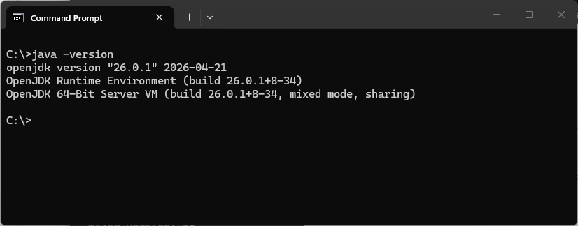
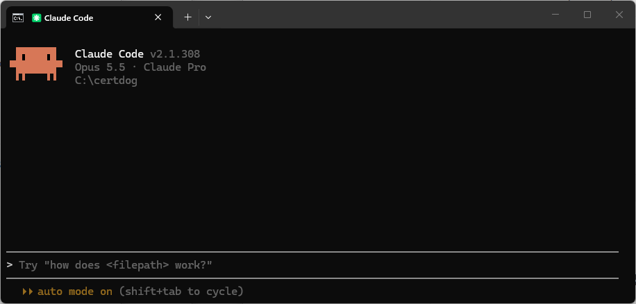

<br>

# AI MCP Setup with Claude

<br>

This guide demonstrates how to configure the certdog MCP server with claude code and desktop. This will then allow the use of natural language to gather data on the certificate estate and the certdog configuration

All of the commands are read-only. If you wish to also allow certificate requests, renewals and revocations then the optional write tools can also be enabled

<br>

## Obtain the MCP server

Contact support to obtain the ``certdog-mcp.jar``

Copy this file to your certdog installation or ideally a folder with no spaces in the path e.g. ``c:\certdog-mcp``

<br>

## Obtain API Keys and Certdog Details

An API key will be required for the AI agent (Claude Code or Desktop) to provide to the MCP server in order to access the certdog API

An admin level user key will allow for searching across the entire certificate estate as well obtaining information on all configs, users and teams

A standard user account will be limited, but this may be preferred if the AI model is running locally (as in claude desktop) and the user operating it is only concerned with their own certificates

For write operations (making certificate requests etc.), it is advisable to create a separate user account that is limited to specific issuers and ideally included in an approval workflow, so that some admin intervention (or other human approver) is required when certificates are being requested/revoked

Create the required API tokens by following the guide [here](users.html#api-tokens)

The API keys obtained are referred to as ``{API TOKEN}`` and ``{USER API TOKEN}`` in the steps below

<br>

The following information is also required:

* Full path to the MCP Server jar
  * E.g. ``c:\certdog\certdog-mcp.jar``
  * This is ``{MCP JAR PATH}`` below
  
* The certdog API URL
  * The URL to the API
  * E.g. https://certdog.svr.local/certdog/api
  * This is ``{API URL}``below

<br>

## TLS Configuration

Clude and the MCP server must trust the TLS certificates presented by the certdog API end point  

If the TLS certificate are issued from a trusted root that is already included within the local java trust store then no additional arguments are required. In this case the following argument (as shown in the examples below):

```properties
-Djavax.net.ssl.trustStoreType=Windows-ROOT
```

Can be removed

On windows machines, if the trusted roots are not present in the java trust store, but are present in the windows trusted root store, then the following argument:

```properties
-Djavax.net.ssl.trustStoreType=Windows-ROOT
```

Will pick them up and the connection to the MCP server will be allowed. This is often the default case and has been included in the samples below  

However, on other systems (linux etc), or where the root certificates have not been imported, then the trusted store (containing the TLS root) must be provided as a pkcs#12 or JKS file.  For example, if the default certdog certificates were still in use, the following arguments would be required:

``` properties
-Djavax.net.ssl.trustStore=C:/certdog/config/sslcerts/dbtrust.jks
-Djavax.net.ssl.trustStorePassword=...
-Djavax.net.ssl.trustStoreType=JKS
```

If the trusted certificates were included in a pkcs#12 store:

```properties
-Djavax.net.ssl.trustStore=C:/certdog/config/sslcerts/truststore.p12
-Djavax.net.ssl.trustStorePassword=...
```

<br>

These changes will alter the configuration set below. E.g. if the JKS file were used then the ``args`` section below would look something like this:

```properties
"args": [
        "-Djavax.net.ssl.trustStore=C:/certdog/config/sslcerts/dbtrust.jks",
        "-Djavax.net.ssl.trustStorePassword=somepassword",
        "-Djavax.net.ssl.trustStoreType=JKS",
        "-jar",
        "{MCP JAR PATH}"
      ]
```

<br>

## Setup with Claude Desktop

Note that Java 21 or later is required. This must be configured on the environment (via JAVA_HOME and path settings) so that Claude Desktop picks up the correct version when starting

<br>

From *Claude Desktop*, click **your account** (usually bottom left) and select **Settings**. Click **Developer** from the left hand options and choose **Edit Config**. Open the file referenced (``claude_desktop_config.json``), if not opened automatically, and edit

<br>

Add the following ``mcpServers`` section at the top of the config, ensuring that you substitute in the correct values for ``{MCP JAR PATH}``, ``{API URL}``and ``{API TOKEN}``:

```json
{
  "mcpServers": {
    "certdog": {
      "command": "java",
      "args": [
        "-Djavax.net.ssl.trustStoreType=Windows-ROOT",
        "-jar",
        "{MCP JAR PATH}"
      ],
      "env": {
        "CERTDOG_URL": "{API URL}",
        "CERTDOG_API_TOKEN": "{API TOKEN}"
      }
    }
  },
  
  
}
```

E.g. so it looks something like this:

```json
{
  "mcpServers": {
    "certdog": {
      "command": "java",
      "args": [
        "-Djavax.net.ssl.trustStoreType=Windows-ROOT",
        "-jar",
        "C:\\certdog\\certdog-mcp.jar"
      ],
      "env": {
        "CERTDOG_URL": "https://certdog.svr.local/certdog/api",
        "CERTDOG_API_TOKEN": "eyJhbGciOiJ...X1-XUBWnKuYLv6"
      }
    }
  },  
  "coworkUserFilesPath": "C:\\Users\\certdog\\Claude",
  "preferences": {
  ...
}
```

Note that the ``coworkUserFilesPath``, ``preferences`` (as shown above) and ``other sections`` will already be present in the config

<br>

If you want to enable write operations (certificate requests, revocation etc.) then also add ``"CERTDOG_WRITE_TOOLS" : true`` to the ``env`` section e.g.

```json
{
  "mcpServers": {
    "certdog": {
      "command": "java",
      "args": [
        "-Djavax.net.ssl.trustStoreType=Windows-ROOT",
        "-jar",
        "C:\\certdog\\certdog-mcp.jar"
      ],
      "env": {
        "CERTDOG_URL": "https://certdog.svr.local/certdog/api",
        "CERTDOG_API_TOKEN": "eyJhbGciOiJ...X1-XUBWnKuYLv6",
        "CERTDOG_WRITE_TOOLS": true
      }
    }
  },  
  "coworkUserFilesPath": "C:\\Users\\certdog\\Claude",
  "preferences": {
  ...
}
```

<br>

If you have created a dedicated account for write operations (certificate requests, revocation etc.) and you only want that account to be used for write operations, then add a second certdog instance such as ``certdog-write``, giving that accounts API key. For example:

```json
{
  "mcpServers": {
    "certdog": {
      "command": "java",
      "args": [
        "-Djavax.net.ssl.trustStoreType=Windows-ROOT",
        "-jar",
        "C:\\certdog\\certdog-mcp.jar"
      ],
      "env": {
        "CERTDOG_URL": "https://certdog.svr.local/certdog/api",
        "CERTDOG_API_TOKEN": "{API TOKEN}"
      }
    },
    "certdog-write": {
      "command": "java",
      "args": [
        "-Djavax.net.ssl.trustStoreType=Windows-ROOT",
        "-jar",
        "C:\\certdog\\certdog-mcp.jar"
      ],
      "env": {
        "CERTDOG_URL": "https://certdog.svr.local/certdog/api",
        "CERTDOG_API_TOKEN": "{USER API TOKEN}",
        "CERTDOG_WRITE_TOOLS": true
      }
    }
  }
```

This will ensure that any write operations are carried out with that user (whose API key is ``{USER API TOKEN}``),  whereas read operations are carried out by an admin user

<br>

Restart Claude Desktop. Close the window and right click the start bar running icon and click **Exit**. Then start

<br>

## Setup with Claude Code

Note that Java 21 or later is required. If running from the command line, confirm this by running:

```
java -version
```



<br>

Start Claude Code from the command line or Desktop app



At the prompt, run the following command:

```
claude mcp add certdog 
	-s user 
	-e CERTDOG_URL={API URL} 
	-e CERTDOG_API_TOKEN={API TOKEN} 
	-- java -Djavax.net.ssl.trustStoreType=Windows-ROOT 
	-jar {MCP JAR PATH}
```

E.g.

```
claude mcp add certdog 
	-s user 
	-e CERTDOG_URL=https://certdog.svr.local/certdog/api 
	-e CERTDOG_API_TOKEN=eyJhbGciOi...1S-J9Lk7A 
	-- java -Djavax.net.ssl.trustStoreType=Windows-ROOT 
	-jar c:\certdog\certdog-mcp.jar
```

(Note, the new lines are added for readability and will need to be removed before running)

<br>

As above, to allow write operations, also provide the ``CERTDOG_WRITE_TOOLS=true`` environment variable:

```
claude mcp add certdog 
	-s user 
	-e CERTDOG_URL=https://certdog.svr.local/certdog/api 
	-e CERTDOG_API_TOKEN=eyJhbGciOi...1S-J9Lk7A 
	-e CERTDOG_WRITE_TOOLS=true
	-- java -Djavax.net.ssl.trustStoreType=Windows-ROOT 
	-jar c:\certdog\certdog-mcp.jar
```

<br>

And if you want to only allow the write operations to be carried out by a restricted user, you may add a second MCP configuration, providing that user's API token:

```
claude mcp add certdog-write 
	-s user 
	-e CERTDOG_URL={API URL} 
	-e CERTDOG_API_TOKEN={USER API TOKEN} 
	-e CERTDOG_WRITE_TOOLS=true
	-- java -Djavax.net.ssl.trustStoreType=Windows-ROOT 
	-jar {MCP JAR PATH}
```

<br>

From the prompt type:

```
/mcp
```

The instance should show as connected. If not, select and choose reconnect

Failure to start is often due to the API not being reachable (certdog service not running), the API key being incorrect or the wrong java version being used. Check these settings if connection fails

<br>

To remove an MCP server run:

```
claude mcp remove certdog
```


