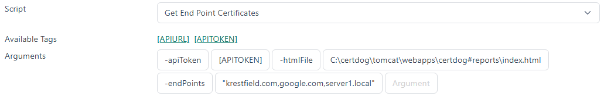
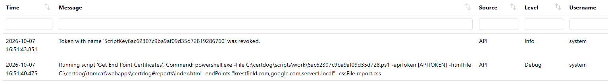
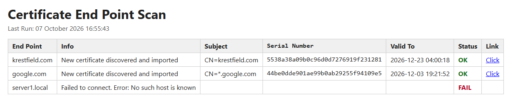
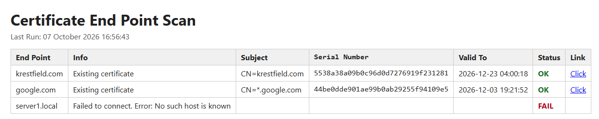

<br>

# End Point Monitoring

<br>

This guide demonstrates how to configure certdog using *Scripts* to monitor a selection of URL endpoints and produce a simple HTML report that can be hosted within the certdog environment  

This demo will attempt to connect to the selected URLs regularly and extract the TLS certificates. These will be imported into certdog for continual monitoring  

<br>

## 1. Obtain the script

The script used in this demo can be downloaded from GitHub here:

[https://github.com/krestfield/certdog-scripts/tree/main/discover-endpoint-certs](https://github.com/krestfield/certdog-scripts/tree/main/discover-endpoint-certs)

Place this in a suitable location. e.g. ``c:\certdog\scripts``

<br>

## 2. Upload the Script

From the *Scripts* menu, upload the script and give it a name e.g. *Get End Point Certificates*. See here for more details on Scripts: [https://krestfield.github.io/docs/certdog/scripts.html](https://krestfield.github.io/docs/certdog/scripts.html)
<br>
## 3. Prepare Data

We will need a list of the end points to be monitored and we will need to create a list from these. As an example, if we wanted to monitor the following:

* krestfield.com

* google.com

* server1.local

We can either create a comma separate list e.g.

```
"krestfield.com,google.com,server1.local"
```

Or an array string:

```
"['krestfield.com', 'google.com', 'server1.local']"
```

Either can be passed to the ``-endPoints`` parameter 

Note that the URLs can also contain the port (if not 443) e.g. ``server1.local:883``

<br>

An HTML file can be produced by the script. We could create a sub folder within the certdog environment to host this however, this can be placed anywhere. To place within the certdog hosting environment, create the following folder:

```
.\certdog\tomcat\webapps\certdog#reports
```

(This can be named anything but the ``certdog#reports`` part means the final URL will appear as ``certdog/reports`` which is consistent with the UI)

We could then set the ``-htmlFile`` parameter to:

```
C:\certdog\tomcat\webapps\certdog#reports\index.html
```

(assuming your certdog is at ``c:\certdog``)

<br>

## 4. Configure the Task

From the *Tasks* menu, click **Add New Task**. Give it a name e.g. *Monitor URLs* and optionally a description  

Set how often you want this to be repeated e.g. once per day or every hour etc.

For *Script*, select the script uploaded in step 2 above

For the *Arguments*, set as follows:

```powershell
-apiToken [APITOKEN] -endPoints {end points} -htmlFile {html filename}
```

Which would result in something like:

```powershell
-apiToken [APITOKEN] -endPoints "krestfield.com,google.com,server1.local" -htmlFile "C:\certdog\tomcat\webapps\certdog#reports\index.html"
```

E.g.



Select the option **Run With User** and select a *user*. This will be the user that the certificates will be associated with. You may want to consider creating a dedicated local user for this purpose. Alternatively, you can run as an Administrator user and pass in the additional ``-userId`` and ``-teamId`` parameters to set the owner details (see *Options* below)

Click **Add**

<br>

## Testing

Allow the script to run. Monitoring the UI logs should show something like:



Local text logs (``.\certdog\logs\certdog.log``) will show further details e.g.

```
2026-10-07 16:52:43.837 DEBUG certdogapi - Script 'Get End Point Certificates' exited with code 0 with output:

Checking end point: krestfield.com
Connected to end point krestfield.com. 1 certificate(s) returned
  Existing certificate
    Id:            6ac63f1bc9ba9af09d35d89e
    Subject:       CN=krestfield.com
    Serial Number: 5538a38a09b0c96d0d7276919f231281
    Valid To:      2026-12-23 04:00:18
    Status:        OK

Checking end point: google.com
Connected to end point google.com. 1 certificate(s) returned
  Existing certificate
    Id:            6ac63f1bc9ba9af09d35d8a0
    Subject:       CN=*.google.com
    Serial Number: 44be0dde901ae99b0ab29255f94109e5
    Valid To:      2026-12-03 19:21:52
    Status:        OK

Checking end point: server1.local
Failed to connect to end point: server1.local. Error: No such host is known
```

<br>

From the browser, navigate to: [https://yourcertdogserver/certdog/reports/](https://yourcertdogserver/certdog/reports/)

And if all has worked OK, the report should be displayed:



Discovered certificates will be imported and can be accessed via the link displayed. Any errors will also be displayed  

Previously discovered certificates will not be re-imported. Their status will just be displayed as *Existing Certificate*:



<br>

If the report is not displayed, check the file system to ensure the ``index.html`` file is being produced at the expected location  

Double check the parameters to the script, ensuring there are surrounding quotes where required  

If this fails, attempt to run the script locally from a PowerShell window with these parameters, manually providing a value for ``-apiToken``   

<br>

## Options

#### Additional Parameters

The following additional parameters can be sent to the script:

* -cssFile

  * If provided a css file can be placed at the report location (or somewhere else, if specified as a full path)

  * A sample report.css is provided in the GitHub location

  * If this was used and placed at the same location as the report the parameter would then be:

  ``-cssFile report.css``

* -htmlReportTitle
  
  * If provided will override the default title with this text e.g.
  
  ``-htmlReportTitle "Company URL Status"``
  
* -ownerId

  * If provided will assign this user as the imported certificates owner

  * Note, you can only assign to a different user if you have authenticated as an admin (apiToken above is an admin user token)

* -teamId

  * If provided will assign this team as the imported certificates team membership

  * Note, you can only assign to a different team if you have authenticated as an admin (apiToken above is an admin user token)

* -extraInfo

  * This can be any string based information and will be stored along-side the certificate

* -includeChain (Switch)

  * If this switch is provided, the entire certificate chain returned from the end point will also be processed

* -timeoutSeconds

  * The timeout period in seconds before the connection to the end point is marked as a failure

  * Defaults to 10 seconds if not provided

* -expiringSoonDays

  * Specify the number of days to show a status of EXPIRING in the report
  * Defaults to 30 days if not provided

<br>

#### Automating

As with everything in certdog, the task setup and editing can be automated via the REST API  

The URLs could therefore be configured in another environment or in a text file etc. and the certdog API could be called to update this task with those URLs dynamically

In this case the call to make would be:

```
PATCH: /admin/task/{id}/update
```

The value for id is the value that appears in the browser address when editing the task from the UI e.g. if the URL is:

```
https://cd.krld.local/certdog/ui/?#/administration/task/6ac623b6c9ba9af09d35d73d/edit
```

Then the ID is ``6ac623b6c9ba9af09d35d73d``

<br>

The body follows this format:

```
{
  "enabled": true,
  "name": "string",
  "description": "string",
  "startingAt": "2026-10-07T15:40:10.955Z",
  "repeatEverySeconds": 0,
  "scriptId": "string",
  "scriptArguments": [
    "string"
  ],
  "runWithUser": true,
  "apiTokenUserId": "string"
}
```

<br>

This call can be tested and expirmented from the Swagger UI (accessed by clicking **API** - bottom right of the certdog UI)
