# EST

> This feature is available from certdog 1.18

Certdog supports the EST protocol - Enrollment over Secure Transport ([RFC7030](https://datatracker.ietf.org/doc/html/rfc7030))

EST lets devices such as routers, switches, firewalls and IoT devices request and renew their own certificates over HTTPS. Many network devices support EST natively, and it is the recommended replacement for SCEP

Multiple EST services can be created - each with a different configuration. This allows for multiple setups that may provide different certificate types, from different CAs, to different groups of devices

## Overview

Each EST service:

* Issues certificates from one **Certificate Issuer**. Devices obtain that issuer's CA certificates from the service
* Has its own **URL**, made from an *alias*. For example, a service with the alias *routers* is at:

  ``https://<server>:8443/.well-known/est/routers``

  Devices add the EST operation to this URL themselves (e.g. ``.../routers/simpleenroll``)
* Decides **how devices authenticate**. The recommended (and default) setup is that each device is given its own **device secret**. The device uses its secret once, to obtain its first certificate, and then renews with that certificate
* Issues certificates to a **team** and **user** that are created for the service, so all certificates issued over EST can be found, reported on and managed in certdog like any other certificate

The following EST operations are supported:

| Operation | Purpose |
| --- | --- |
| ``/cacerts`` | Returns the CA certificates (the issuing CA first). No authentication required |
| ``/simpleenroll`` | Request a new certificate |
| ``/simplereenroll`` | Renew a certificate, authenticating with the current certificate |
| ``/serverkeygen`` | certdog generates the key and returns it with the certificate (when enabled) |
| ``/csrattrs`` | Returns the attributes devices should include in their requests (when configured) |

### The EST Port

EST is served by its own HTTPS connector, on port **8443** by default (or the next free port if certdog itself uses 8443). This connector asks devices for a TLS client certificate, which is how devices authenticate when they renew, without affecting the certdog console or API

Make sure devices can reach this port, e.g. open it on any firewalls between the devices and certdog

> Note that the EST URL is always at the root of the server (``/.well-known/est``) as required by RFC 7030. It is not under ``/certdog``

## Configuration

From the menu, select **Interfaces** and then choose **EST**

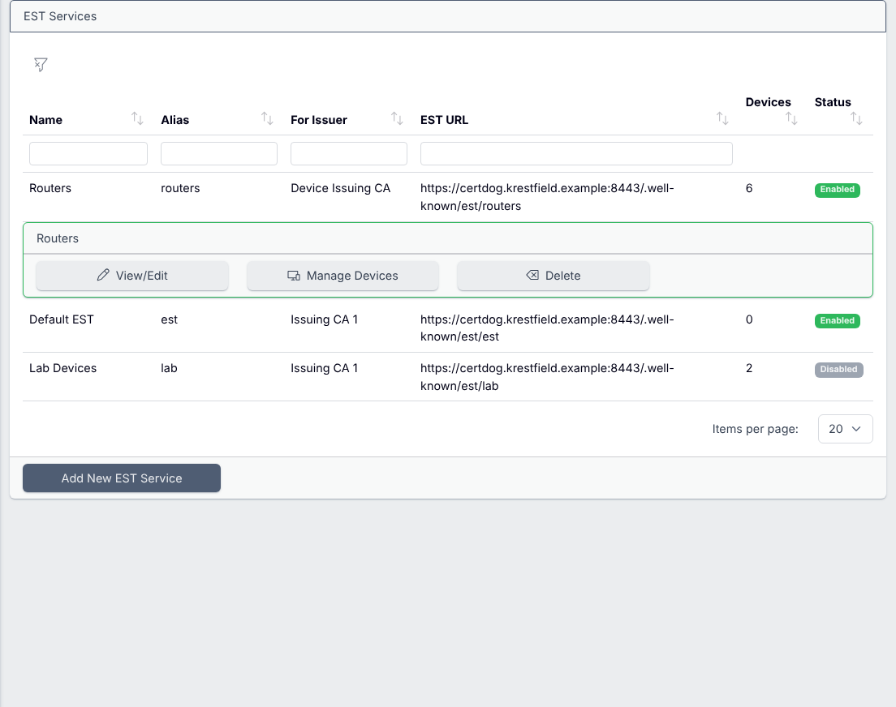

Click **Add New EST Service**

The recommended settings are already selected. In most cases you only need to enter a name and alias and choose the certificate issuer

### Service and Certificates

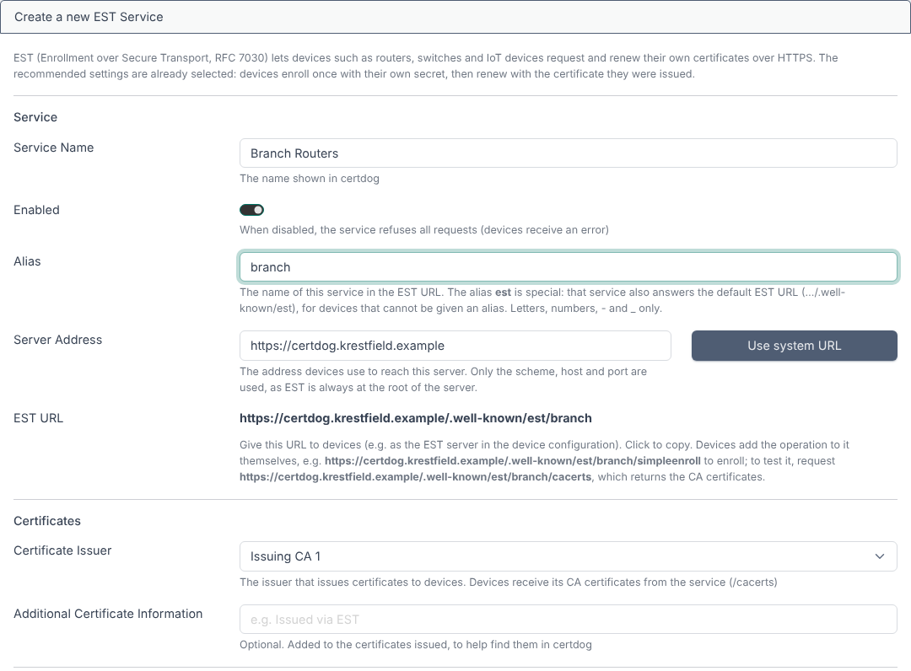

* **Service Name**. Enter a name. This identifies the service in certdog. Devices do not see this value
* **Enabled**. This enables the service. When disabled, devices receive an error for all requests
* **Alias**. The name of this service in the EST URL. Letters, numbers, ``-`` and ``_`` only. Each service must have its own alias. The alias **est** is special: the service with this alias also answers the default EST URL (``https://<server>:8443/.well-known/est``) for devices that cannot be configured with an alias
* **Server Address**. The address devices use to reach certdog. This is pre-populated from the [System URL](post-Installation.html#set-the-system-url). Only the scheme, host and port are used. If devices reach certdog using a different DNS name, or via a load balancer, update it here. Include the EST port if it is not the default HTTPS port (e.g. ``https://certdog.example.com:8443``). Click **Use system URL** to revert to the stored system URL
* **EST URL**. This is calculated from the Server Address and Alias, and is the URL to configure on devices. Click it to copy it
* **Certificate Issuer**. The issuer that issues certificates to devices. Devices receive this issuer's CA certificates from ``/cacerts``
* **Additional Certificate Information**. Optional. Any information entered here is added to the certificates issued, to help find them in certdog

### How Devices Authenticate

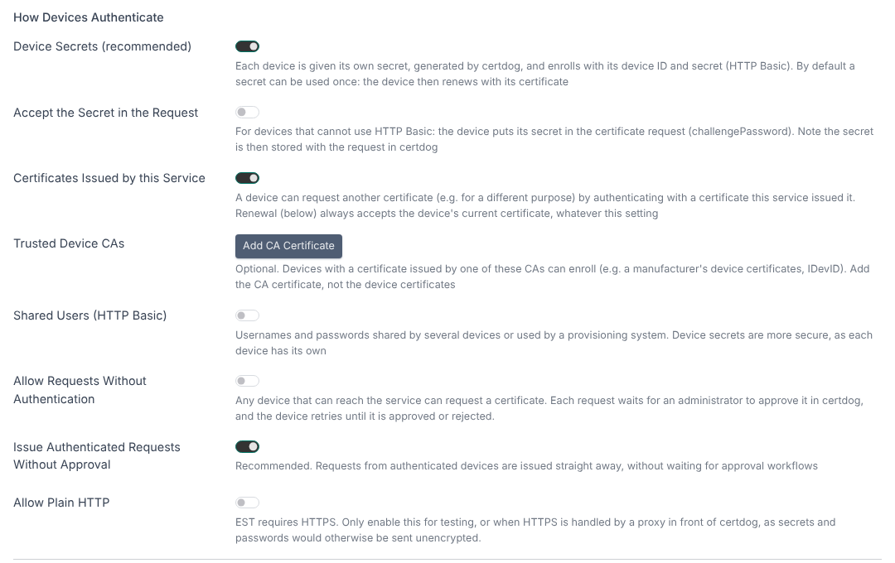

* **Device Secrets (recommended)**. Each device is given its own secret, generated by certdog (see [Managing Devices](#managing-devices)). The device enrolls using its device ID as the username and its secret as the password (HTTP Basic authentication). By default a secret can only be used once: the device then renews with the certificate it was issued
* **Accept the Secret in the Request**. For devices that cannot use HTTP Basic authentication. The device puts its secret in the certificate request (the *challengePassword* attribute) instead. Note that the secret is then stored with the request in certdog
* **Device ID Subject Field**. When **Accept the Secret in the Request** is enabled, the field of the request's subject that holds the device ID (e.g. ``CN=router-0001``). One of CN, SERIALNUMBER, UID, E or OU
* **Certificates Issued by this Service**. A device can request another certificate (e.g. for a different purpose) by authenticating with a certificate this service issued it. Renewal always accepts the device's current certificate, whatever this setting
* **Trusted Device CAs**. Optional. Devices with a certificate issued by one of these CAs can enroll, for example a manufacturer's device certificate (IDevID). Click **Add CA Certificate** and add the CA certificate (not the device certificates)
* **Shared Users (HTTP Basic)**. Usernames and passwords that can be shared by several devices, or used by a provisioning system. Click **Add User** to add each one. Passwords must be at least 12 characters. Device secrets are more secure, as each device has its own
* **Allow Requests Without Authentication**. Any device that can reach the service can request a certificate. Each request waits for an administrator to approve it in certdog, and the device retries until it is approved or rejected. See [Unauthenticated Requests](#unauthenticated-requests)
* **Issue Authenticated Requests Without Approval**. Recommended. Requests from authenticated devices are issued straight away, without waiting for any approval [Workflows](workflows.html)
* **Allow Plain HTTP**. EST requires HTTPS. Only enable this for testing, or when HTTPS is handled by a proxy in front of certdog, as secrets and passwords would otherwise be sent unencrypted

### Renewal and Server Key Generation

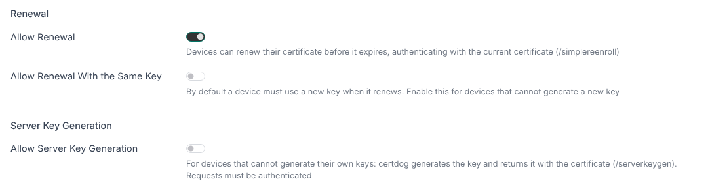

* **Allow Renewal**. Devices can renew their certificate before it expires, authenticating with their current certificate (``/simplereenroll``)
* **Allow Renewal With the Same Key**. By default a device must use a new key when it renews. Enable this for devices that cannot generate a new key
* **Allow Server Key Generation**. For devices that cannot generate their own keys. certdog generates the key and returns it with the certificate (``/serverkeygen``). These requests must be authenticated
* **CSR Generator**. Shown when server key generation is enabled. The [CSR Generator](create_csr_generator.html) that sets the type and size of the keys generated

### Advanced

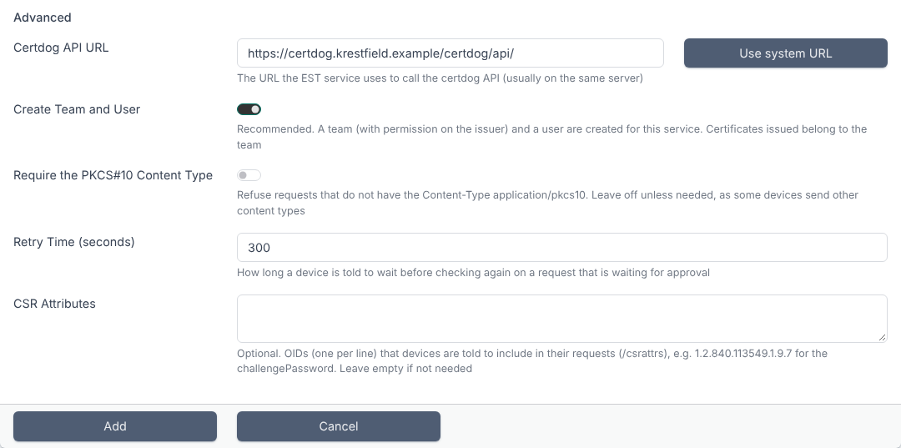

* **Certdog API URL**. The URL the EST service uses to call the certdog API. This is usually on the same server and is pre-populated. If certdog is clustered this may need to be updated. Click **Use system URL** to revert to the stored system URL
* **Create Team and User**. Recommended. A team (with permission on the certificate issuer) and a user are created for this service, and certificates issued belong to the team. If this is unchecked, choose an existing **Team** and **User**. The team must have permission on the issuer and the user must be a member of the team. If **Issue Authenticated Requests Without Approval** is set, the user must also be allowed to bypass approval workflows. The created team is given the built-in *EST Service* role. If you use an existing team, it must have a role that permits the calls the EST service makes (e.g. the *EST Service* role). See [Service Roles](roles.html#service-roles)
* **Require the PKCS#10 Content Type**. Refuse requests that do not have the content type ``application/pkcs10``. Leave this off unless needed, as some devices send other content types
* **Retry Time (seconds)**. How long a device is told to wait before checking again on a request that is waiting for approval. The default is 300
* **CSR Attributes**. Optional. OIDs (one per line) that devices are told to include in their requests (``/csrattrs``), e.g. ``1.2.840.113549.1.9.7`` for the challengePassword. Leave empty if not needed

Click **Add**

## Managing Devices

When **Device Secrets** are enabled, each device that will enroll must be added to the service. From the EST menu, select the service and choose **Manage Devices**

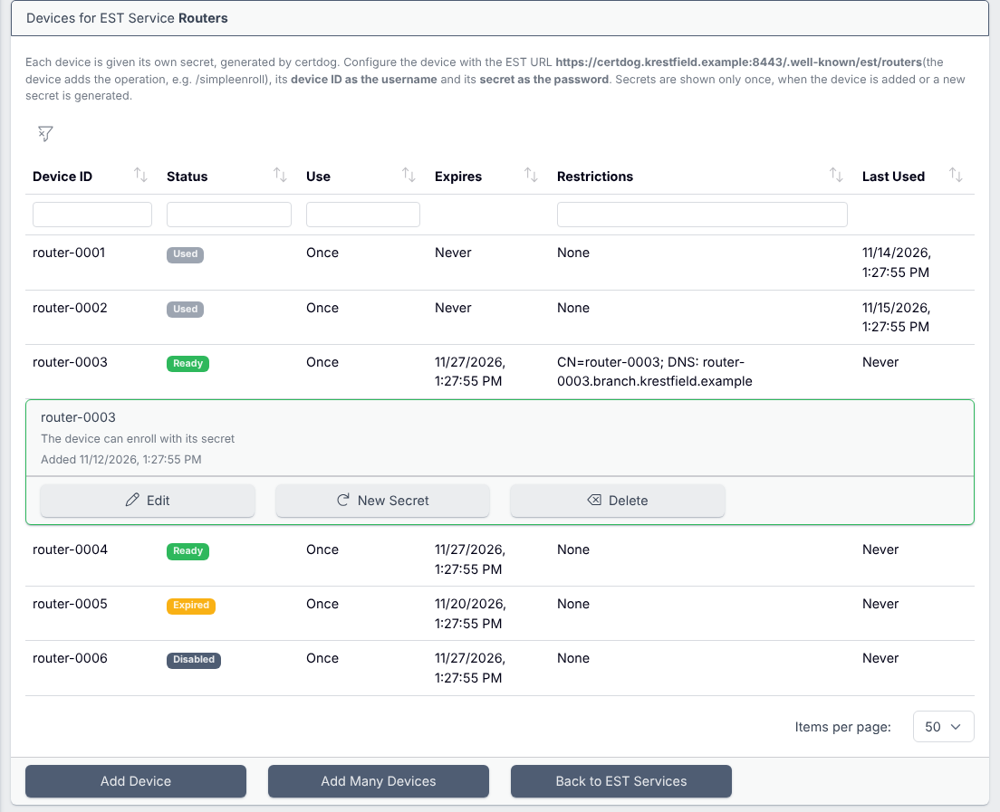

Each device has a **Status**:

| Status | Meaning |
| --- | --- |
| **Ready** | The device can enroll with its secret |
| **Pending** | The device has used its secret for a request that is waiting for approval. It can repeat the same request |
| **Used** | The secret has obtained a certificate. The device now renews with that certificate. Generate a new secret to onboard it again |
| **Expired** | The secret has expired. Change the expiry or generate a new secret to onboard the device |
| **Disabled** | The secret cannot be used. Edit the device to enable it |

Click a device to see more details, including a link to the certificate it obtained

### Adding a Device

Click **Add Device**

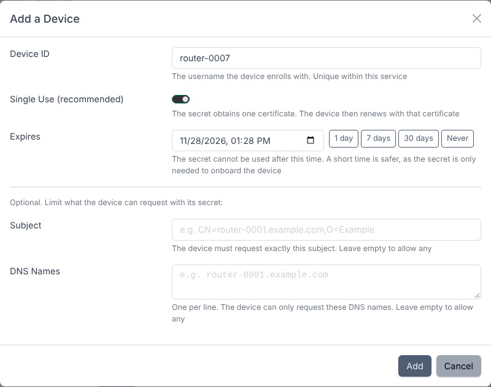

* **Device ID**. The username the device enrolls with. This must be unique within the service
* **Enabled**. When disabled, the secret cannot be used
* **Single Use (recommended)**. The secret obtains one certificate. The device then renews with that certificate. If this is unchecked the secret can be used again, so anyone who learns it can obtain certificates for this device until it expires
* **Expires**. The secret cannot be used after this time. A short time is safer, as the secret is only needed to onboard the device. Use the buttons to set 1, 7 or 30 days, or **Never**
* **Subject**. Optional. The device must request exactly this subject (e.g. ``CN=router-0007``). Leave empty to allow any
* **DNS Names**. Optional. One per line. The device can only request these DNS names. Leave empty to allow any

Click **Add**. The device's secret is displayed:

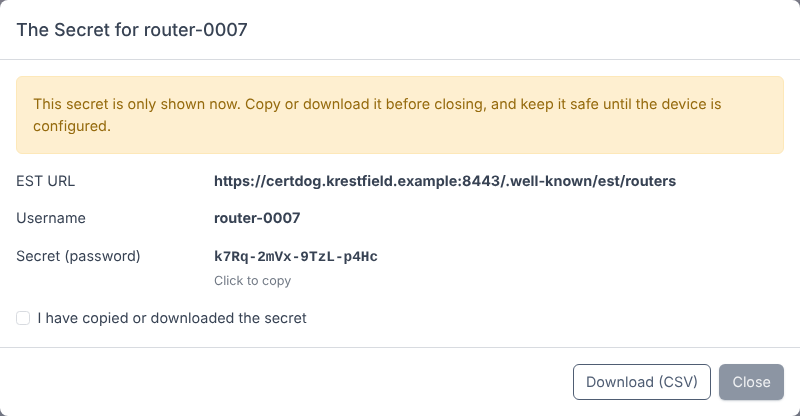

> The secret is only shown once. Copy it, or click **Download (CSV)**, before closing. Certdog stores only a hash of the secret, so it cannot be displayed again. If it is lost, generate a new secret

Configure the device with the **EST URL**, the device ID as the **username** and the secret as the **password**

### Adding Many Devices

To add several devices at once, click **Add Many Devices**

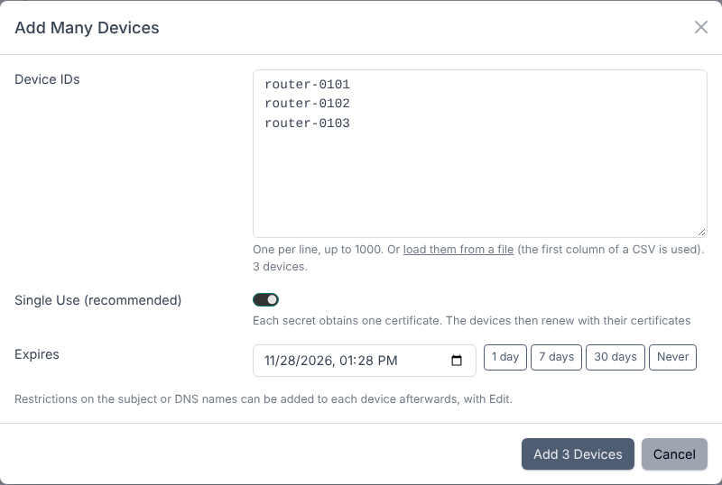

Enter the device IDs, one per line, or click **load them from a file** to load them from a text or CSV file (the first column of a CSV file is used). Set **Single Use** and **Expires** as above, then click **Add**

The secrets for all of the devices are displayed. Click **Download (CSV)** to save them, with the EST URL, for configuring the devices

Restrictions on the subject or DNS names can be added to each device afterwards, with **Edit**

### Generating a New Secret

To onboard a device again (e.g. after it has been reset, or if its secret was lost), select the device and choose **New Secret**. A new secret is generated and displayed, and the previous secret stops working

### Editing and Deleting Devices

Select the device and choose **Edit** to change whether it is enabled, single use, its expiry or its restrictions

Select the device and choose **Delete** to remove it. Its secret stops working. A certificate it has already obtained is not affected (revoke it in certdog if needed)

## Unauthenticated Requests

When **Allow Requests Without Authentication** is enabled, any device that can reach the service can request a certificate. These requests are not issued straight away: the device is told to retry later (after the **Retry Time**), and the request waits for an administrator to approve it

When the service is created, a workflow is created that requires an administrator to approve these requests (**Create Approval Workflow**). Alternatively, uncheck this and choose an existing [Workflow](workflows.html). Without an approval workflow, unauthenticated requests would be issued without approval

Approve or reject the requests from the **Approvals** menu. The device obtains its certificate the next time it retries after the request is approved

## Editing a Service

From the EST menu, select the service and choose **View/Edit**

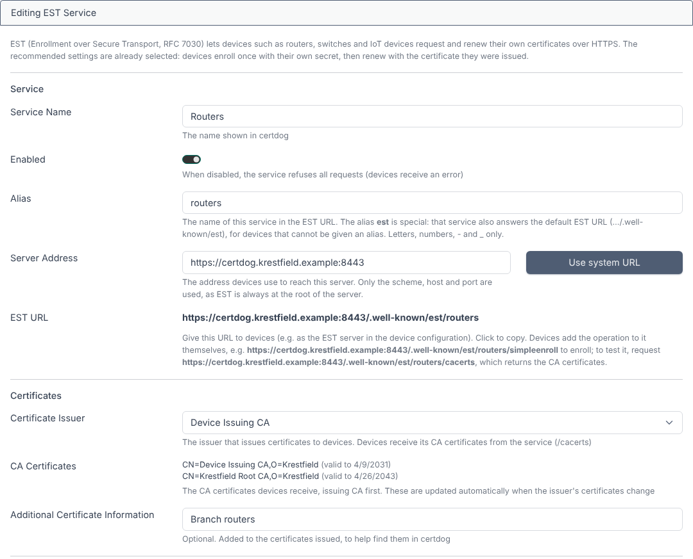

The settings previously entered are displayed and can be changed. The **CA Certificates** that devices receive are also listed. These are updated automatically when the issuer's certificates change

In the **Advanced** section, the team and user the service uses are shown:

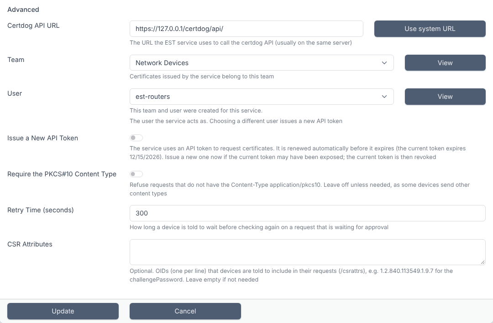

* **Team** and **User**. Click **View** to view or edit them. Choosing a different user issues a new API token
* **Issue a New API Token**. The service uses an API token to request certificates. It is renewed automatically before it expires. Check this to issue a new token now, if the current token may have been exposed. The current token is then revoked

Click **Update** to save the new settings

### Disabling a Service

From the EST menu, select the service and choose **View/Edit**

Uncheck **Enabled** and click **Update**

All requests to a disabled service are rejected. Its devices and their secrets are kept

### Deleting a Service

From the EST menu, select the service and choose **Delete**

Click **Yes** to confirm

Devices can no longer enroll with the service, and its devices and their secrets are deleted. Certificates already issued are not affected

## Testing a Service

The following examples use ``curl`` and ``openssl`` to test a service with the alias *routers* and a device *router-0007*. EST messages are base64 encoded

**Obtain the CA certificates**

```bash
curl https://certdog.example.com:8443/.well-known/est/routers/cacerts | base64 -d > cacerts.p7
openssl pkcs7 -inform DER -in cacerts.p7 -print_certs -out cacerts.pem
```

**Enroll with a device secret**

```bash
openssl req -new -newkey ec -pkeyopt ec_paramgen_curve:prime256v1 -nodes -keyout router.key -subj "/CN=router-0007" -outform DER -out router.csr
base64 router.csr > router.b64
curl --cacert cacerts.pem --user router-0007:<secret> -H "Content-Type: application/pkcs10" --data-binary @router.b64 https://certdog.example.com:8443/.well-known/est/routers/simpleenroll | base64 -d > router.p7
openssl pkcs7 -inform DER -in router.p7 -print_certs -out router.pem
```

> If ``--cacert`` fails, the EST port's TLS certificate was not issued by the CA returned by ``/cacerts``. Use the CA that issued certdog's TLS certificate instead

**Renew with the current certificate**

```bash
openssl req -new -newkey ec -pkeyopt ec_paramgen_curve:prime256v1 -nodes -keyout router-new.key -subj "/CN=router-0007" -outform DER -out renew.csr
base64 renew.csr > renew.b64
curl --cacert cacerts.pem --cert router.pem --key router.key -H "Content-Type: application/pkcs10" --data-binary @renew.b64 https://certdog.example.com:8443/.well-known/est/routers/simplereenroll | base64 -d > renewed.p7
```

The issued certificates can be found in certdog under the service's team

## REST API

EST services and their devices can also be managed with the REST API. See the API documentation (Swagger) on your certdog server for the details:

| Method | Path | Purpose |
| --- | --- | --- |
| GET | ``/admin/est`` | List the EST services |
| POST | ``/admin/est/add`` | Add a service |
| GET | ``/admin/est/{id}`` | Get a service |
| PATCH | ``/admin/est/{id}/update`` | Update a service |
| DELETE | ``/admin/est/{id}`` | Delete a service |
| GET | ``/admin/est/{id}/devices`` | List a service's devices |
| POST | ``/admin/est/{id}/devices/add`` | Add a device (returns its secret) |
| POST | ``/admin/est/{id}/devices/addmany`` | Add several devices (returns their secrets) |
| PATCH | ``/admin/est/{id}/devices/{deviceId}/update`` | Update a device |
| POST | ``/admin/est/{id}/devices/{deviceId}/newsecret`` | Generate a new secret |
| DELETE | ``/admin/est/{id}/devices/{deviceId}`` | Delete a device |
