# Revocation Monitor

> This feature is available from certdog 1.18

<br>

The Revocation Monitor continually checks the OCSP responders and CRLs (Certificate Revocation Lists) that your certificates depend on, and alerts you when they fail

If an OCSP responder stops responding, or a CRL is not republished before it expires, relying parties can no longer check whether certificates have been revoked. Depending on the application, certificates may then be rejected (causing an outage) or accepted without a revocation check. The Revocation Monitor detects these problems early - usually before the CRL or OCSP response actually expires

It can monitor any OCSP responder or CRL: those provided by certdog's own [Local CAs](create_local_certificate_issuer.html) and [OCSP servers](ocsp.html), Microsoft AD CS, public CAs and partner CAs

> This replaces the stand-alone [CRL OCSP Monitor](../ocsp-monitor/ocsp-monitor.html) Windows application

<br>

## Overview

Each **monitor** checks one OCSP responder or one CRL location on a schedule (e.g. every minute):

* **OCSP monitors** send an OCSP request for a certificate and check the response: that the responder answered in time, that the response is correctly signed by an authorised responder, that it is current and that the certificate has the expected status (e.g. *Good*)
* **CRL monitors** download a CRL and check it: that it downloaded in time, that it is correctly signed by the CA, that it is current and has enough time left before it expires, and optionally that a given certificate is (or is not) on the list

Every check is recorded, so the **history** of each monitor can be viewed - for example when response times increased, or when a server behind a load balancer first started to fail

When a monitor starts failing, and again when it recovers, **alerts** can be sent by email, by webhook (e.g. to Microsoft Teams or Slack) and as certdog **notifications**

Both RSA, EC and post-quantum (ML-DSA, SLH-DSA) signatures are supported

<br>

## Viewing Monitors

From the menu, select **Monitoring** and then choose **Revocation Monitors**

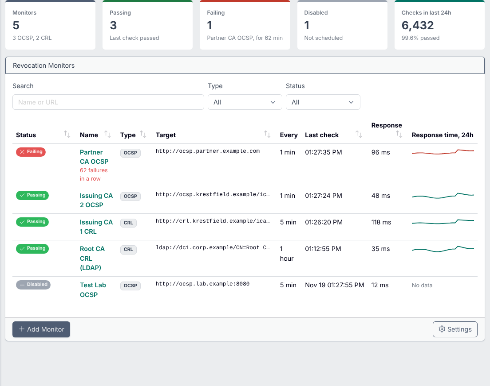

The tiles at the top show how many monitors there are, how many are passing, failing and disabled, and how many checks have run in the last 24 hours

Each monitor is listed with its status, type, target URL, how often it runs, when it was last checked, its last response time and its response times over the last 24 hours. Use **Search**, **Type** and **Status** to filter the list

Click a monitor (anywhere on its row) to show its actions:

* **Run now** - run the check straight away
* **History** - view its history (see [Monitoring History](#monitoring-history))
* **Edit** - change its settings
* **Disable** / **Enable** - stop or restart its checks. A disabled monitor is not checked and sends no alerts
* **Delete** - delete the monitor and its history

<br>

## Creating a Monitor

From the Revocation Monitors page, click **Add Monitor**

Only the certificate and issuer (OCSP) or the CRL location (CRL) are required. Everything else starts with sensible defaults

<br>

### 1. What to Monitor - OCSP

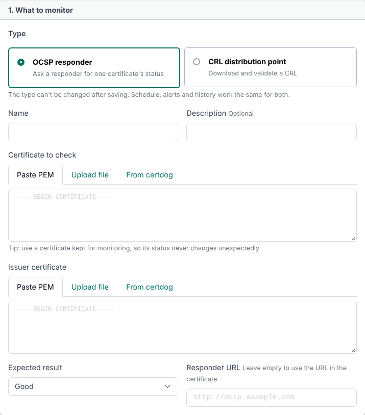

* **Type**. Choose **OCSP responder**. The type cannot be changed after the monitor is saved
* **Name**. A name for the monitor. This must be unique
* **Description**. Optional
* **Certificate to check**. The certificate the OCSP request is made for. Paste it (PEM), upload a file, or choose it from certdog (see below). It is best to use a certificate kept for monitoring, so that its status never changes unexpectedly
* **Issuer certificate**. The CA certificate that issued the certificate to check
* **Expected result**. The status the responder should return for the certificate: **Good**, **Revoked**, **Unknown** or **Try later**. For example, to check that revocations are being published, monitor a test certificate that has been revoked on purpose and expect *Revoked*
* **Responder URL**. Leave this empty to use the OCSP URL in the certificate (its AIA extension). Enter a URL to check a specific responder, e.g. one node behind a load balancer

<br>

#### Choosing Certificates From Certdog

The **Certificate to check** and **Issuer certificate** each have a **From certdog** tab, to choose a certificate that is already in certdog instead of pasting it:

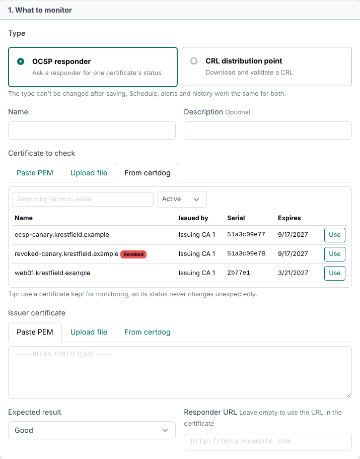

Search by name or serial number and choose **Active**, **Revoked** or **All** certificates. Click **Use** to choose a certificate

When an issuer has already been chosen, the switch **Only certificates issued by...** limits the list to certificates that issuer really issued. The issuer list shows CA certificates only

When the certificate to check is chosen, certdog also:

* Fills in its **issuer**, if certdog holds the issuer's certificate (e.g. from a Local CA or a Certificate Issuer). If certdog does not hold it, you are asked to choose or paste it
* Warns if a different issuer had already been chosen, and offers to use the correct one
* Sets **Expected result** to *Revoked* if the certificate is revoked
* Fills in the **Name**, if it is empty

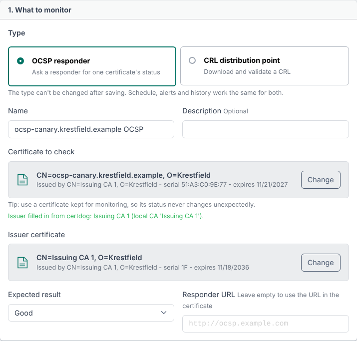

> When a monitor is saved, certdog checks that the issuer certificate really issued the certificate to check (by its signature). If not, the monitor is not saved and an error is shown

<br>

### 1. What to Monitor - CRL

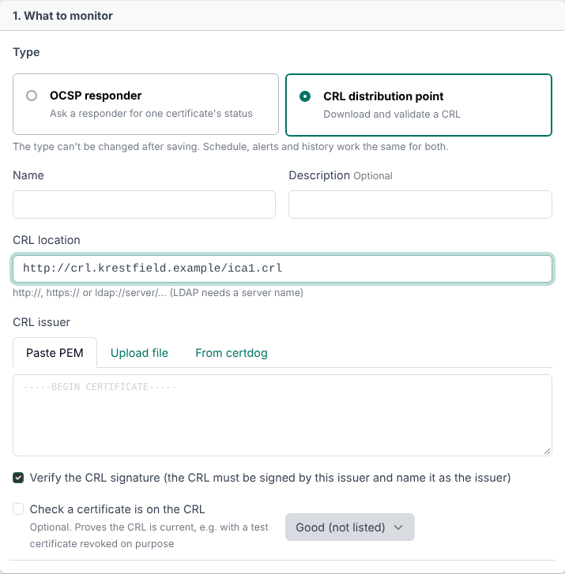

* **Type**. Choose **CRL distribution point**
* **Name** and **Description**. As above
* **CRL location**. The URL of the CRL. ``http://``, ``https://`` and ``ldap://`` URLs are supported. LDAP URLs must include the server name e.g. ``ldap://dc1.example.com/CN=Issuing CA,CN=CDP,...?certificateRevocationList?base``
* **CRL issuer**. The CA certificate that signs the CRL. This can also be chosen **From certdog**
* **Verify the CRL signature**. Checks that the CRL is signed by this issuer and names it as the issuer. This is recommended
* **Check a certificate is on the CRL**. Optional. Choose the certificate to look for and whether it should be **Revoked (listed)** or **Good (not listed)**. For example, a test certificate revoked on purpose proves the CRL is current

<br>

### 2. Schedule

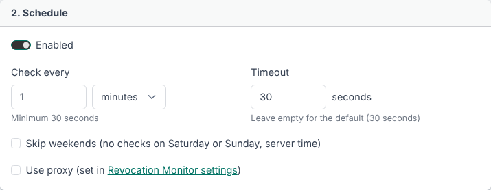

* **Enabled**. When unchecked, the monitor is saved but not checked
* **Check every**. How often the check runs. The minimum is 30 seconds (this can be changed, see [Settings](#settings))
* **Timeout**. How long to wait for a response. Leave empty for the default (30 seconds for OCSP, 60 for CRLs)
* **Skip weekends**. No checks are run on Saturday or Sunday (server time)
* **Use proxy**. The check is made through the proxy set in the Revocation Monitor [Settings](#settings). Use this for responders and CRLs on the internet when certdog cannot reach them directly

<br>

### 3. Checks

The checks that are always made are described above. Further checks can be added here

**OCSP**

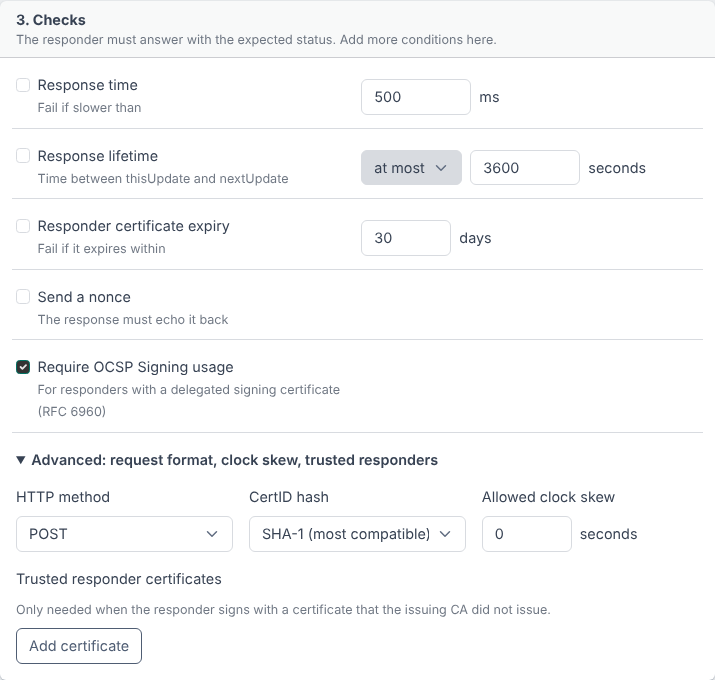

* **Response time**. Fail if the response takes longer than this
* **Response lifetime**. Fail if the time between the response's *thisUpdate* and *nextUpdate* is more (or less) than this
* **Responder certificate expiry**. Fail if the responder's signing certificate expires within this many days
* **Send a nonce**. Include a nonce in the request. The response must echo it back. Note that many responders (and all that pre-produce responses) do not support nonces
* **Require OCSP Signing usage**. For responders that sign with a delegated certificate, the certificate must have the OCSP Signing extended key usage (RFC 6960). This is recommended

Under **Advanced: request format, clock skew, trusted responders**:

* **HTTP method**. POST (the default) or GET
* **CertID hash**. The hash used to identify the certificate in the request. SHA-1 is the most compatible
* **Allowed clock skew**. Allow for clock differences between certdog and the responder, in seconds
* **Trusted responder certificates**. Only needed when the responder signs with a certificate that the issuing CA did not issue

**CRL**

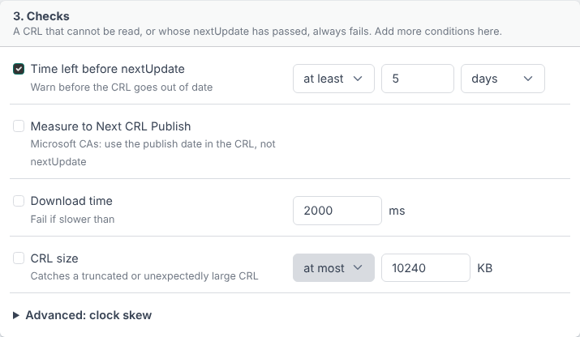

* **Time left before nextUpdate**. Fail if the CRL has less (or more) than this time left before its *nextUpdate*. Check **Measure to Next CRL Publish** to measure to the CRL's *Next CRL Publish* time instead, when present (as published by Microsoft AD CS). This warns that a CRL has not been republished well before it expires
* **Download time**. Fail if the download takes longer than this
* **CRL size**. Fail if the CRL is larger (or smaller) than this. An unexpectedly small CRL can indicate a problem with publishing
* **Allowed clock skew**. Under **Advanced: clock skew**

<br>

### 4. Alerts

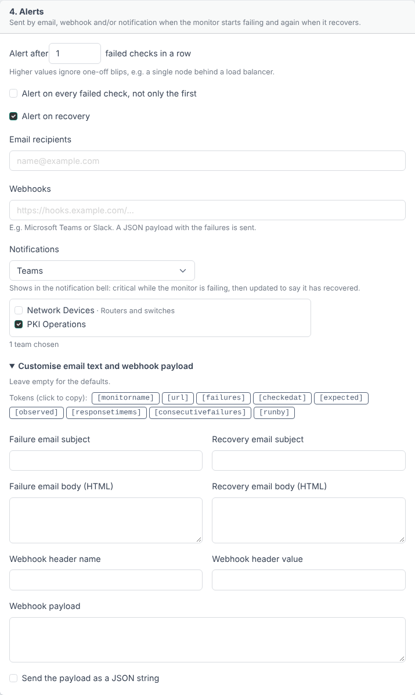

* **Alert after**. An alert is sent once this many checks in a row have failed. Higher values ignore one-off blips, e.g. a single node behind a load balancer failing once
* **Alert on every failed check, not only the first**. By default one alert is sent when the monitor starts failing. Check this to be alerted on every failed check
* **Alert on recovery**. Send an alert when a monitor that had alerted starts passing again
* **Email recipients**. The email addresses to send alerts to. Certdog's [Email Settings](email_settings.html) must be configured
* **Webhooks**. URLs to send a JSON message to, e.g. a Microsoft Teams or Slack incoming webhook. See [MS Teams Notifications](ms_teams_notifications.html) for how to create a Teams webhook
* **Notifications**. Send a certdog notification to **Everyone**, to chosen **Teams** or to chosen **Users**. See [Alerts](#alerts) below

Under **Customise email text and webhook payload**, the email subjects and bodies and the webhook payload can be changed. Leave these empty for the defaults. The following tokens can be used, and are replaced with the values from the check (click a token to copy it):

| Token | Value |
| --- | --- |
| ``[monitorname]`` | The monitor's name |
| ``[url]`` | The URL checked |
| ``[failures]`` | Why the check failed |
| ``[checkedat]`` | When the check ran |
| ``[expected]`` | The expected certificate status |
| ``[observed]`` | The status returned |
| ``[responsetimems]`` | The response time in milliseconds |
| ``[consecutivefailures]`` | How many checks in a row have failed |
| ``[runby]`` | The certdog server that ran the check |

* **Webhook header name** / **value**. An optional HTTP header sent with webhooks, e.g. for authentication
* **Webhook payload**. The JSON sent to the webhooks. If empty, a default JSON payload with the details of the check is sent
* **Send the payload as a JSON string**. Sends the payload as a single JSON string value (for services that expect this)

<br>

### 5. History

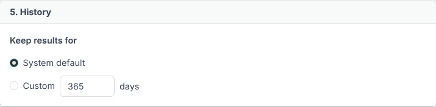

* **Keep results for**. How long this monitor's results are kept. **System default** uses the server setting (90 days by default, see [Settings](#settings)). Choose **Custom** to keep this monitor's results for a different number of days

<br>

### Testing and Saving

Click **Test** to run the check once, with the settings entered, without saving anything. The result is displayed, including the full transcript of the check:

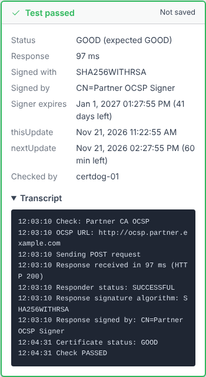

Click **Save monitor** to save it. The first check runs straight away

<br>

## Monitors for Local CAs

Monitors can be created for certdog's own [Local CAs](create_local_certificate_issuer.html), with the details filled in from the CA

<br>

### When Creating a CA

When creating a new Local CA with **Generate CRLs** checked, the option **Monitor this CRL** is shown (checked by default):


When the CA is created, a CRL monitor is added for each of its CRL distribution points (HTTP and LDAP). The CA's certificate is used as the issuer, the signature is checked, and the remaining lifetime alert is set from the CA's CRL lifetime and generation settings. The first check runs about two minutes after the CA is created, by which time its first CRL has been published

> This option is not available for an intermediate CA whose certificate is requested from an external CA (CSR). Add the monitor from the CA's page (below) once its certificate has been accepted

<br>

### For an Existing CA

From **Local CAs**, choose **CA Configuration**, select the CA and choose **Edit**. The **Revocation monitoring** section shows the monitors that already watch the CA's CRL and OCSP URLs:

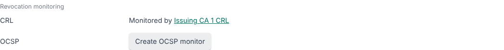

* **Create CRL monitor**. Adds a CRL monitor for each of the CA's CRL distribution points that is not already monitored
* **Create OCSP monitor**. Opens a new OCSP monitor with the name, issuer and OCSP URL filled in from the CA. Choose the certificate to check, from the list of certificates the CA has issued, and click **Save monitor**. This is only available once the CA has issued at least one certificate, as an OCSP check needs a real certificate from the CA

<br>

## Editing, Disabling and Deleting a Monitor

**Editing**. From the Revocation Monitors page, select the monitor and choose **Edit** (or click **Edit** on its history page). Change the settings and click **Save monitor**. The monitor is checked straight away with the new settings

**Disabling**. Select the monitor and choose **Disable**. It is not checked and sends no alerts until it is enabled again. Its history is kept. Alternatively, uncheck **Enabled** when editing the monitor

**Deleting**. Select the monitor and choose **Delete**, then click **Yes** to confirm. The monitor and all of its history are deleted. Any notification it raised is removed

<br>

## Monitoring History

From the Revocation Monitors page, click the monitor and choose **History**:

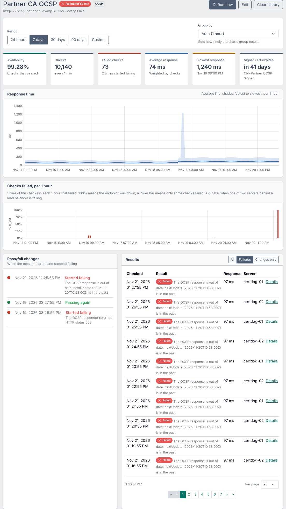

* **Period**. Show the last **24 hours**, **7 days**, **30 days**, **90 days**, or a **Custom** range
* **Group by**. How finely the charts group results, e.g. per minute or per hour. **Auto** chooses a suitable size for the period

The tiles show, for the period:

* **Availability**. The percentage of checks that passed
* **Checks**. How many checks ran
* **Failed checks**. How many checks failed, and how many times the monitor started failing
* **Average response** and **Slowest response**
* **Signer cert expires** (OCSP) or **Next update** (CRL)

The charts show:

* **Response time**. The average response time (line), with the fastest to slowest response shaded. Use this to see when response times changed
* **Checks failed**. The share of checks that failed in each period. 100% means the endpoint was down; a lower bar means only some checks failed, e.g. 50% when one of two servers behind a load balancer is failing

**Pass/fail changes** lists each time the monitor started failing and when it passed again, with the reason

**Results** lists the individual checks. Choose **All**, **Failures** or **Changes only**, and use the page controls to move through them. Click **Details** to view a check

On the history page you can also **Run now**, **Edit** the monitor, or **Clear history** (delete all of its results)

<br>

### Check Details

Each check's details show why it failed, the details of the check and of the response, and the full transcript of the check:

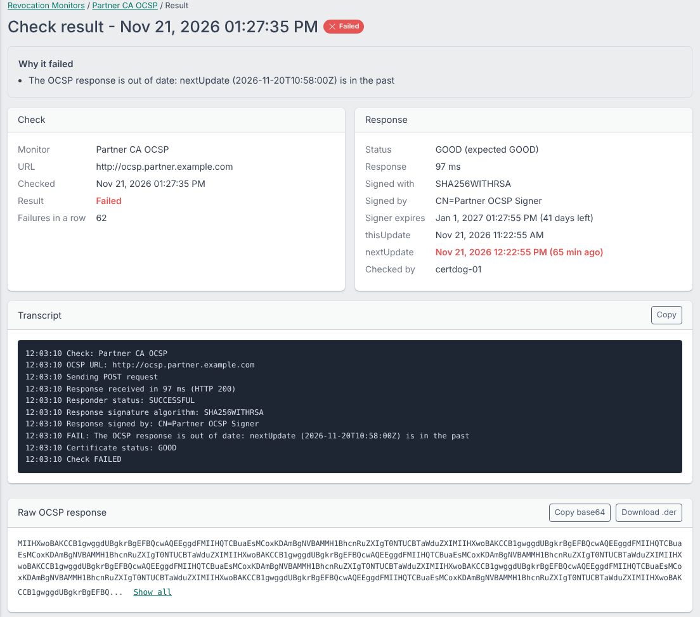

For failed checks the raw OCSP response is kept, and can be copied (base64) or downloaded (``.der``) to examine with other tools e.g. ``openssl ocsp -respin response.der -resp_text``

> By default the transcript and raw response are kept for failures and for checks where the monitor changed between passing and failing. The pass/fail result, response time, size and validity of every check are always kept. See *Detail kept* in [Settings](#settings)

<br>

## Alerts

Alerts are sent when a monitor starts failing (once the **Alert after** number of checks in a row have failed) and, if **Alert on recovery** is set, when it passes again. With **Alert on every failed check** set, an alert is sent for each failed check

All alerts are also written to the certdog log

<br>

### Email

Emails are sent to each of the **Email recipients**. The default email includes the monitor's name and type, how many times it has failed in a row, the URL, when and by which server it was checked, the expected and received status, and why it failed. The recovery email includes the response time

The email text can be changed with the tokens listed [above](#4-alerts). Email is sent using certdog's [Email Settings](email_settings.html)

<br>

### Webhooks

A JSON message is posted to each webhook URL. By default this contains:

```json
{
  "event": "failure",
  "monitor": "Partner CA OCSP",
  "monitorId": "6740...",
  "type": "OCSP",
  "url": "http://ocsp.partner.example.com",
  "passed": false,
  "checkedAt": "2026-11-21T12:03:10Z",
  "consecutiveFailures": 3,
  "failures": "The OCSP response is out of date: nextUpdate (2026-11-20T10:58:00Z) is in the past"
}
```

The ``event`` is ``failure`` or ``recovery``. Use a custom **Webhook payload** for services that need a particular format, such as Microsoft Teams or Slack

<br>

### Notifications

A certdog notification can be sent to **Everyone**, to chosen **Teams**, or to chosen **Users**. It appears in the notification bell at the top of the certdog console

Each monitor raises **one** notification, which follows its state:

* When the monitor starts failing, a **Critical** notification is raised, e.g. *Revocation monitor failing: Partner CA OCSP*, with the reason
* If it keeps failing (with **Alert on every failed check**), the same notification is updated rather than adding more. The number of times it has occurred is shown
* When it recovers, the same notification is updated to **Info**, e.g. *Revocation monitor recovered: Partner CA OCSP*

Each update shows as unread again. The notification is removed when the monitor is deleted or when its notifications are turned off

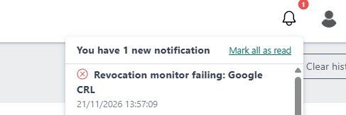

<br>

## The Dashboard

Administrators see the Revocation Monitor on the certdog **Dashboard**: a summary of passing and failing monitors, and the status of each monitor over the last 24 hours (one square per hour), with what expires next and recent changes:

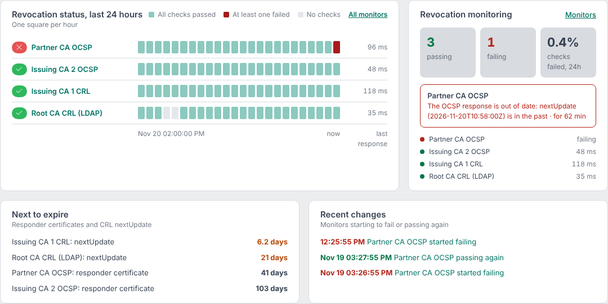

<br>

## Settings

From the Revocation Monitors page, click **Settings**

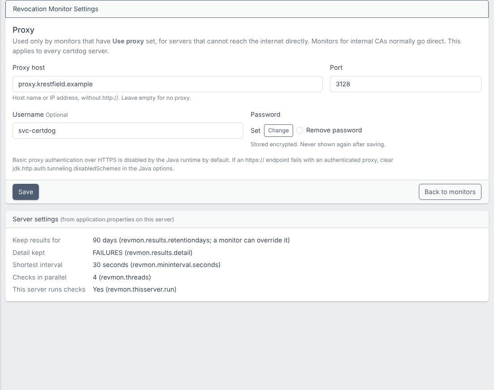

**Proxy**. The proxy used by monitors that have **Use proxy** set, for servers that cannot reach the internet directly. Monitors for internal CAs normally go direct. This applies to every certdog server

* **Proxy host** and **Port**. Leave the host empty for no proxy
* **Username** and **Password**. Optional. The password is stored encrypted and is never displayed again. Click **Change** to replace it, or check **Remove password**

> Basic proxy authentication over HTTPS is disabled by the Java runtime by default. If an ``https://`` endpoint fails with an authenticated proxy, clear ``jdk.http.auth.tunneling.disabledSchemes`` in the Java options

**Server settings** are set in certdog's ``application.properties`` file on each server, and are displayed here for reference. All are optional. The defaults are:

| Setting | Default | Description |
| --- | --- | --- |
| ``revmon.thisserver.run`` | true | Set to false to stop this server running checks. With several certdog servers, checks are shared between those that have this set to true. Each check runs once, on one server |
| ``revmon.threads`` | 4 | The maximum number of checks run in parallel on this server |
| ``revmon.mininterval.seconds`` | 30 | The shortest interval allowed between checks of one monitor |
| ``revmon.results.retentiondays`` | 90 | Results older than this many days are deleted. A monitor can override this |
| ``revmon.results.purge.cron`` | ``0 25 3 * * ?`` | When old results are deleted (3:25am every day) |
| ``revmon.results.detail`` | FAILURES | How much detail is stored with each result: ``ALL``, ``FAILURES`` (failures and changes between passing and failing) or ``NONE``. The pass/fail result, response time, size and validity are always stored |
| ``revmon.results.maxtoreturn`` | 5000 | The maximum number of results returned by one history request |
| ``revmon.allowfileurls`` | false | Allow ``file://`` CRL locations (reads files on the certdog server) |
| ``revmon.proxy.host`` / ``.port`` / ``.username`` / ``.password`` | | A proxy to use when none is set on the Settings page |

Restart certdog after changing these settings

<br>

## REST API

Monitors can also be managed with the REST API. See the API documentation (Swagger) on your certdog server for the details:

| Method | Path | Purpose |
| --- | --- | --- |
| GET | ``/admin/revmon`` | List the monitors |
| POST | ``/admin/revmon/add`` | Add a monitor |
| GET | ``/admin/revmon/{id}`` | Get a monitor |
| PATCH | ``/admin/revmon/{id}/update`` | Update a monitor |
| DELETE | ``/admin/revmon/{id}`` | Delete a monitor and its history |
| POST | ``/admin/revmon/test`` | Run a check without saving it |
| POST | ``/admin/revmon/{id}/run`` | Run a monitor now |
| GET | ``/admin/revmon/{id}/results`` | Get a monitor's results |
| GET | ``/admin/revmon/{id}/stats`` | Get a monitor's statistics, grouped by time |
| GET | ``/admin/revmon/summary`` | The status of all monitors (as on the Dashboard) |
| GET / PATCH | ``/admin/revmon/settings`` | Get or update the proxy settings |
| POST | ``/admin/revmon/certificates/search`` | Search certdog's certificates to monitor |
| GET | ``/admin/revmon/localca/{caId}/template`` | The details needed to monitor a Local CA |
| POST | ``/admin/revmon/localca/{caId}/crl-monitors`` | Add CRL monitors for a Local CA |
