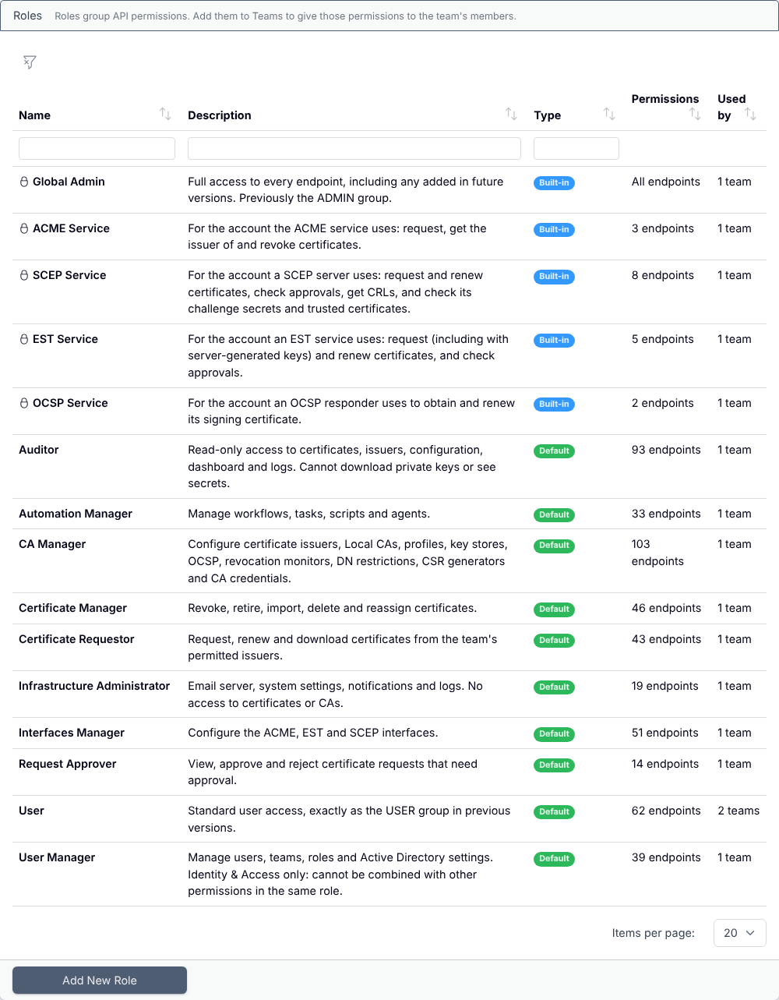
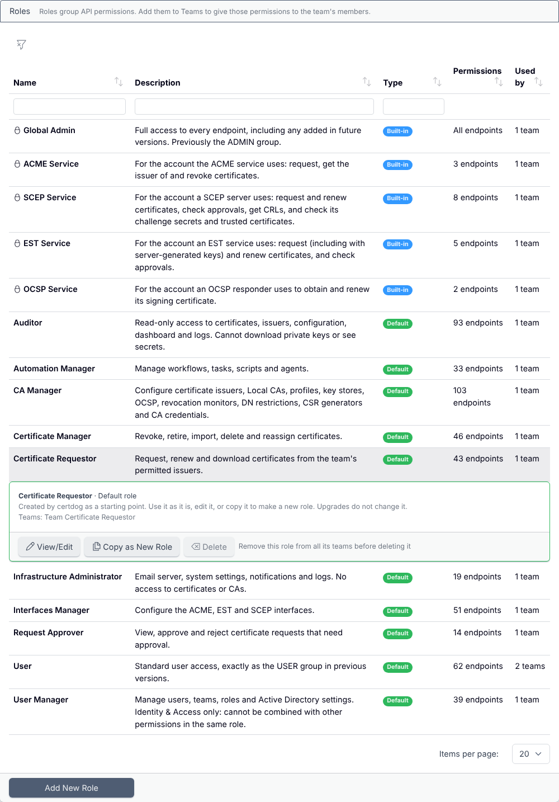
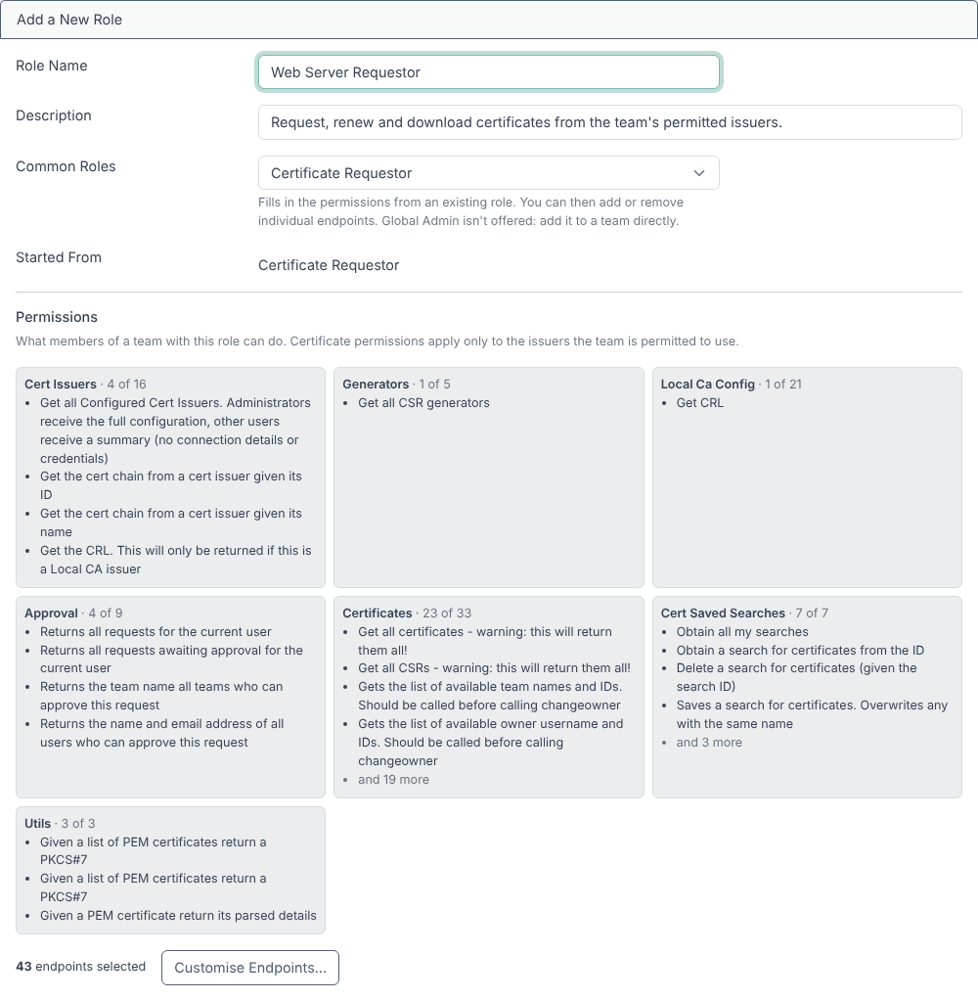
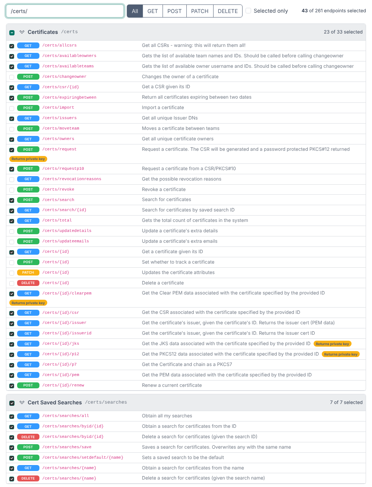
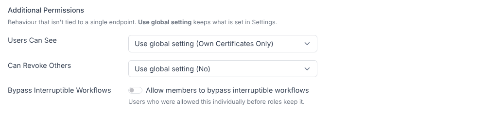
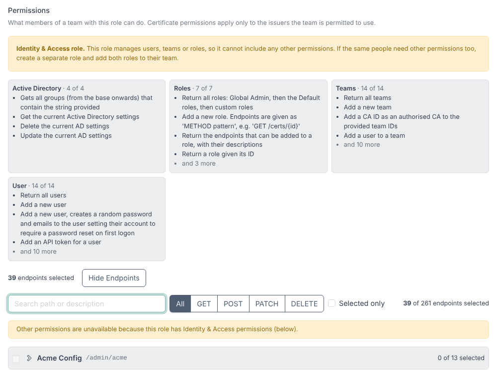
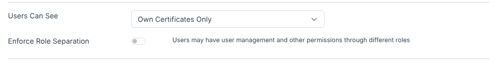
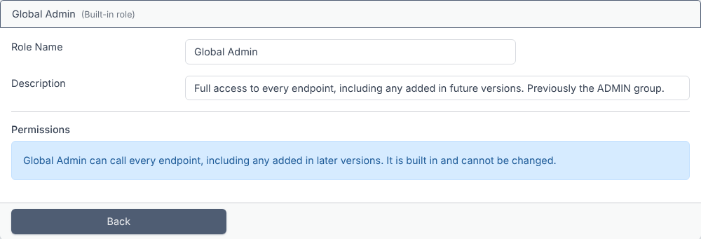

# Roles

*Available from version 1.18*

Roles define what users are permitted to do in certdog. Each role is a list of the REST API end points (e.g. ``GET /certs/{id}`` or ``POST /certs/requestp10``) that its members may call. As the certdog UI uses the same REST API, a role controls access from the UI as well as from the API  

Roles are not given to users directly. They are added to [Teams](teams.html) and every member of the team then has the permissions of those roles. A team must have at least one role  

Three settings together decide what a user can do:

1. **Roles** (set on the Team). Which operations the user can carry out, e.g. request certificates, approve requests or configure Certificate Issuers
2. **Permitted Certificate Issuers** (set on the Team). Which Certificate Issuers the user can use. Certificate permissions in a role only apply to the issuers that the team is permitted to use
3. **The Certificate Issuer's own settings**. For example, whether DN requests are allowed, which CSR Generators may be used and any DN Restrictions

For example, a member of a team with the *Certificate Requestor* role, whose team is permitted to use the *Internal TLS Issuer*, can request certificates from the *Internal TLS Issuer* only  

Prior to version 1.18, teams were either *Administrator* teams or standard teams. These are now the **Global Admin** and **User** roles. See [Upgrading from 1.17](#upgrading-from-117) below for how existing teams are updated  

<br>

---

### Types of Role

There are three types of role:

* **Built-in**
  * These are maintained by certdog and cannot be edited or deleted. They are updated automatically when certdog is upgraded
  * **Global Admin** permits access to all end points, including any added in future versions. This is the equivalent of the *Administrator* team option in previous versions
  * The **ACME Service**, **SCEP Service**, **EST Service** and **OCSP Service** roles are for the accounts that these services use to call certdog. See [Service Roles](#service-roles) below

* **Default**
  * These are created by certdog when it is first installed (or upgraded to 1.18) and are provided as starting points
  * They may be used as they are, edited, copied or deleted
  * They are not changed when certdog is upgraded and, if deleted, they are not re-created

* **Custom**
  * Roles that you create

<br>

**Default Roles**

| Role | Description |
| --- | --- |
| User | Standard user access, exactly as standard (non-administrator) users had in previous versions |
| Certificate Requestor | Request, renew and download certificates from the team's permitted issuers |
| Certificate Manager | Revoke, retire, import, delete and reassign certificates |
| Request Approver | View, approve and reject certificate requests that need approval |
| CA Manager | Configure Certificate Issuers, Local CAs, profiles, key stores, OCSP, revocation monitors, DN restrictions, CSR generators and CA credentials |
| Automation Manager | Manage workflows, tasks, scripts and agents |
| Interfaces Manager | Configure the ACME, EST and SCEP interfaces |
| Infrastructure Administrator | Email server, system settings, notifications and logs. No access to certificates or CAs |
| User Manager | Manage users, teams, roles and Active Directory settings. See [Identity & Access](#identity--access) below |
| Auditor | Read-only access to certificates, issuers, configuration and logs. Cannot download private keys or see secrets (such as CA credentials, SCEP challenge secrets, ACME EAB keys or EST device secrets) |

<br>

**Available to all users**

Some things do not need to be included in a role as all logged in users can access them:

* Their own account (via the  icon) e.g. viewing their teams, changing their password and revoking their own API tokens
* Logging out
* The **Dashboard**. The dashboard only shows information on the certificates the user is permitted to see (see *Users Can See* under [Additional Permissions](#additional-permissions)). Sections that require other permissions (such as the Revocation Monitor) are only shown to users that have those permissions

<br>

---

### View Roles

Select **Roles** from the menu (under *Administration*)  



All roles are listed with their type, how many end points they permit and how many teams they are used by. Built-in roles are shown with a padlock  

Click on a role to see more details and the options available:



* **View/Edit**. View or edit the role. Built-in roles can be viewed but not edited
* **Copy as New Role**. Create a new role starting with the same permissions
* **Delete**. A role can only be deleted when it is not used by any team. Remove the role from all teams first

<br>

---

### Add a Role

Select **Roles** from the menu and click **Add New Role** (or select an existing role and click **Copy as New Role**)



Enter a **Role Name** and optionally a **Description**  

**Common Roles**. Optionally, choose an existing role to start from. Its permissions (and description, if one has not been entered) are copied into the new role. You can then add or remove individual end points. Global Admin is not offered here - if a team needs full access, add the *Global Admin* role to the team directly  

The *Permissions* section summarises what members of a team with this role will be able to do, grouped by area  

<br>

**Customise Endpoints**

Click **Customise Endpoints...** to choose individual end points:



The list of end points is obtained from the running certdog API so it is always up to date. The descriptions are the same as those in the API documentation (Swagger)  

* End points are grouped by area. Click the arrow next to a group to expand it, or check the group's checkbox to select or deselect all of its end points
* Type in the **Search** box to filter on the path or description
* Click **GET**, **POST**, **PATCH** or **DELETE** to only show end points with that method
* Check **Selected only** to only show the end points currently in the role

Some end points are labelled to highlight their significance:

* **Returns private key**. The end point can return a private key (e.g. downloading a PKCS#12 or JKS)
* **Affects access**. The end point can change settings that affect what users can do e.g. updating the global settings
* **Can act as that user**. The end point allows the caller to act as another user e.g. creating an API token for a user

If a role contains end points that no longer exist (e.g. after an upgrade where an end point was removed), these will be listed. Click **Remove from role** to remove them  

<br>

<a name="additional-permissions"></a>**Additional Permissions**



These permissions are not tied to a single end point:

* **Users Can See**. Which certificates members can see: *Own Certificates Only*, *Teams Certificates* or *All Certificates*. Choose **Use global setting** to use the *Users can see* value from [Settings](settings.html)
* **Can Revoke Others**. Whether members can revoke certificates that they can see but do not own. Choose **Use global setting** to use the *Can Revoke Others* value from [Settings](settings.html)
* **Bypass Interruptible Workflows**. Members can bypass interruptible [workflows](workflows.html) when calling the API (e.g. a service that has already authorised a request). Users that had *Can Bypass Interruptible Workflows* set on their account before roles were introduced keep this permission

Note that members can only download keys associated with certificates that they own, regardless of what they can see  

Click **Add Role**  

The role can now be added to teams. See [Teams](teams.html)

<br>

---

### Identity & Access

End points that manage **Users**, **Teams**, **Roles** and **Active Directory** settings are grouped together as *Identity & Access*. Anyone with these permissions can change who has access to certdog, so they are kept separate:

* A role that contains Identity & Access end points cannot contain any other end points, and a role that contains other end points cannot contain Identity & Access end points
* If the same people need both, create two roles and add both to their team



The default **User Manager** role is an Identity & Access role  

The following end points are marked **Lookup** in the end point list. These only return lists of names and can be included in any role, so that other pages (such as choosing approvers in a workflow or choosing which teams get a new Certificate Issuer) still work:

* ``GET /admin/users`` and ``GET /admin/users/usernames``
* ``GET /admin/teams``
* ``GET /admin/teams/issuers``

<br>

**Safeguards**

Users that manage users, teams or roles but are not *Global Admins* are restricted as follows. They cannot:

* Change their own account, their own team memberships, or any team they are a member of
* Change a role that is assigned to any team they are a member of
* Add the *Global Admin* role to a team, change a team that has the *Global Admin* role, or change who is a member of that team
* Update, reset the password of, disable, delete or create API tokens for a *Global Admin* user

This prevents a user from using user management to give themselves (or others) more access. In addition, for everyone (including Global Admins), there must always be at least one enabled Global Admin  

If an operation is refused, a message is displayed explaining why  

<br>

**Enforce Role Separation**

Roles are combined across teams (see below), so a user who is a member of two teams could have Identity & Access permissions from one team and other permissions from another. By default this is permitted  

To prevent this, select **Settings > Settings** from the menu and switch on **Enforce Role Separation**



When switched on, users whose teams give them Identity & Access permissions together with any other permissions are refused (they cannot log in, and any API calls they make are refused). Global Admins are not affected  

<br>

---

### Combining Roles

A team can have several roles, and a user can be a member of several teams. A user's permissions are the combination of every role of every team they are a member of  

For example, if *bob* is a member of the *Web Servers* team, which has the *User* role, and the *Auditors* team, which has the *Auditor* role, bob can do everything that both roles allow  

For the [Additional Permissions](#additional-permissions), where roles differ, the most permissive value is used. For example, if one role sets *Users Can See* to *Own Certificates Only* and another sets it to *Teams Certificates*, the user can see their teams' certificates  

The *Permitted Certificate Issuers* of the user's teams are also combined. This means a user's role permissions apply to every issuer permitted by any of their teams. For example, if *alice* is a member of the *Web Servers* team (*Certificate Requestor* role, permitted to use the *Internal TLS Issuer*) and the *Devices* team (*Auditor* role, permitted to use the *Device Issuer*), alice can request certificates from both the *Internal TLS Issuer* and the *Device Issuer*  

Bear this in mind when adding users to multiple teams. If permissions must be kept separate, use separate user accounts  

When editing a team, the *Effective permissions* panel shows what the team's roles allow together. See [Teams](teams.html)

<br>

---

### Service Roles

The ACME, SCEP, EST and OCSP services each use a certdog user account to request certificates. The built-in service roles permit only the end points each service calls:

| Role | End points |
| --- | --- |
| ACME Service | ``POST /certs/requestp10``, ``GET /certs/{id}/issuer``, ``POST /certs/revoke`` |
| SCEP Service | ``POST /certs/requestp10``, ``POST /certs/{id}/renew``, ``GET /certs/{id}``, ``GET /approval/{id}``, ``GET /admin/ca/crl/{id}``, ``POST /scep/{id}/secrets/validate``, ``POST /scep/{id}/secrets/mark``, ``POST /scep/{id}/trustedCerts/isTrusted`` |
| EST Service | ``POST /certs/requestp10``, ``POST /certs/request``, ``GET /certs/{id}``, ``POST /certs/{id}/renew``, ``GET /approval/{id}`` |
| OCSP Service | ``POST /certs/requestp10``, ``POST /certs/{id}/renew`` |

When a service creates its own team and user (e.g. the *Auto Generate Credentials* option for [ACME](acme.html) and [SCEP](scep.html), *Create Team and User* for [EST](est.html), or the team created for an [OCSP](ocsp.html) server), the new team is given the matching service role  

As these roles are built in, they cannot be deleted and are kept up to date by certdog. If you choose an existing team and user for a service instead, make sure the team has the service role (or another role that includes the same end points)  

The service roles do not allow workflows to be bypassed. If a service must bypass interruptible workflows, either allow this on the service user's account or add a role with **Bypass Interruptible Workflows** set to the team  

<br>

---

### Upgrading from 1.17

When certdog is upgraded to 1.18, existing access is unchanged:

* The Default roles are created
* Teams that were *Administrator* teams are given the **Global Admin** role
* All other teams are given the **User** role. This role permits exactly what standard users could do in previous versions
* Teams that were created by the ACME, SCEP, EST and OCSP services are also given their service role (alongside the User role). The User role can be removed from these teams once you have confirmed the service is working
* The global *Users can see* and *Can Revoke Others* settings continue to apply to all roles (all Default roles are set to *Use global setting*)
* Users with *Can Bypass Interruptible Workflows* set on their account keep this permission

Existing users continue to be able to do exactly what they could before the upgrade. You may then create roles and update teams as required  

Workflows that obtain approval from *Any Admin* continue to work, with members of *Global Admin* teams able to approve. New workflows should obtain approval from a *Team* instead. See [Workflows](workflows.html)  

Applications that set or read a team's *Administrator* option via the REST API (the team's ``internalGroup`` value) continue to work. Setting ``internalGroup`` to ``ADMIN`` gives the team the Global Admin role. The team's ``roleIds`` value lists its roles  

<br>

---

### Global Admin



Global Admin permits access to everything, including any end points added in future versions of certdog. It is recommended that only a small number of users are Global Admins and that the [Global Admin team](ip_restricting.html#recommendations-and-tips) is restricted to specific IP addresses  

Where possible, give users roles that permit only what they need (e.g. CA Manager or User Manager) instead  

<br>

---

### What Users See

The menu only shows the items that a user's roles permit. For example, a member of a team with only the *CA Manager* role will see the *Dashboard*, *Certificate Issuers*, *Local CAs* and other CA configuration items, but not *Certificates*, *Users* or *Teams*  

If a user attempts to call an end point (via the API) that their roles do not permit, a ``403 Forbidden`` response is returned  

To see a user's permissions, view the teams they are a member of (from **Users**, select the user) and the *Effective permissions* of each team. A user can view their own permissions via the REST API: ``GET /currentuser/permissions``

<br>

---

### REST API

Roles can also be managed with the REST API. See the API documentation (Swagger) on your certdog server for the details:

| Method | Path | Purpose |
| --- | --- | --- |
| GET | ``/admin/roles`` | List the roles |
| GET | ``/admin/roles/endpoints`` | List the end points that can be added to a role, with their descriptions |
| GET | ``/admin/roles/{id}`` | Get a role |
| GET | ``/admin/roles/{id}/teams`` | List the teams that use a role |
| POST | ``/admin/roles/add`` | Add a role |
| PATCH | ``/admin/roles/{id}/update`` | Update a role |
| DELETE | ``/admin/roles/{id}`` | Delete a role (only when no team uses it) |
| GET | ``/currentuser/permissions`` | The permissions of the logged in user |

End points are given as the method and path, as shown in the API documentation e.g.

```json
{
    "name": "Web Server Requestor",
    "description": "Request certificates from a CSR and download them",
    "endpoints": [
        "POST /certs/requestp10",
        "GET /certs/{id}",
        "GET /certs/{id}/pem",
        "GET /admin/ca"
    ]
}
```

To add roles to a team, include the role IDs in the team's ``roleIds`` when adding or updating the team (``POST /admin/teams/add`` or ``PATCH /admin/teams/{id}/update``)
