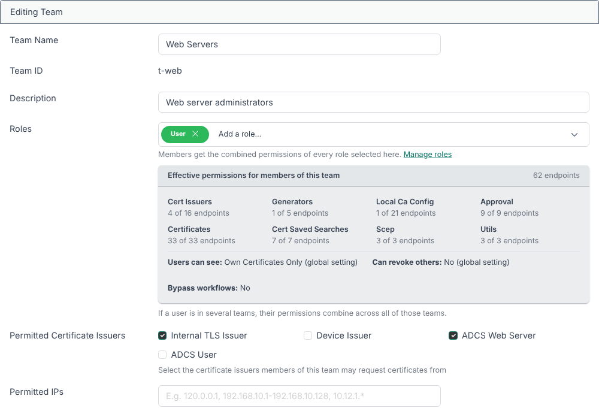
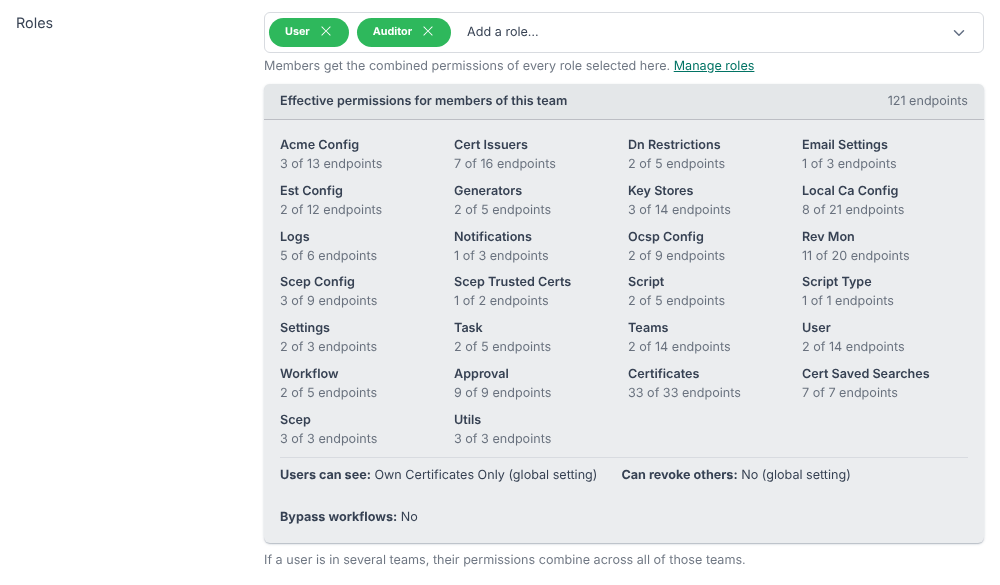
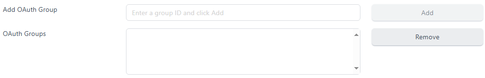
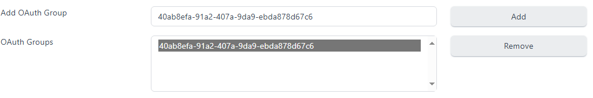

# Teams


Teams manage what users can do in certdog. Users that are members of these teams inherit the team's permissions (in the same way as Groups and members of groups work in Active Directory)  

A team defines:

* The **Roles** of its members. Roles define which operations members can carry out e.g. request certificates, approve requests or configure Certificate Issuers. See [Roles](roles.html)
* The **Permitted Certificate Issuers**. The *Certificate Issuers* members can use  

Teams can also restrict members from specific IP Addresses (or ranges of IP Addresses) and suppress email sending to its members  

If the Team has the *Global Admin* role, all members of that team are Certdog Administrators and can manage all aspects of the system  

Note: Prior to version 1.18, a team was either marked as *Administrator* or not. From version 1.18, *Administrator* teams have the *Global Admin* role and other teams have the *User* role. See [Roles](roles.html#upgrading-from-117)  

Users can be members of multiple teams  

By default, one team exists called *Admin Team* which has the *Global Admin* role. The initial admin user is a member of this team meaning they can manage all aspects of the system  

You may add, remove or edit teams as per your requirements and make users members of as many teams as required.  Generally, it is advisable to maintain a single administrator team (rather than multiple). A typical administrator team, as well as having the *Global Admin* role, may also restrict IP Addresses to localhost (127.0.0.1) or specific IP Addresses, meaning that administrators can only authenticate from the local machine or specific machines or networks, thus increasing security  

If you have configured Active Directory (so that users can authenticate to Certdog with their domain accounts), then you can also map Active Directory groups to a team (see more below)  

<br>

---

### Add a Team

Select **Teams** from the menu, click **Add New  Team**




Enter a **name** and optionally, a **description**  

**Roles**

Select the **Roles** for members of this team from the *Add a role...* list. A team must have at least one role. New teams start with the *User* role, which can be removed once another role has been added. To remove a role, click the **x** next to it  

If you wish to make everyone in this team an administrator, add the **Global Admin** role  

The *Effective permissions* panel shows what members of the team will be able to do with the selected roles combined, including the [Additional Permissions](roles.html#additional-permissions) (what certificates they can see, whether they can revoke others' certificates and whether they can bypass workflows):



Note that if a user is a member of several teams, their permissions are combined across all of those teams. See [Combining Roles](roles.html#combining-roles)  

Click **Manage roles** to view or create roles. See [Roles](roles.html)  

**Permitted Certificate Issuers**

Select the **Certificate Issuers** that you want to be available to members of this team. The certificate permissions in the team's roles (e.g. requesting or revoking certificates) only apply to these issuers  

<br>

**Active Directory Groups**

If Active Directory has been configured you will also see the following option:


This is where you can map Active Directory groups to this team. For example, if your PKI certificate security staff were all members of an Active Directory group called PKI_CERT_MANAGERS then you could specify that group here. If this Team had the Global Admin role, then all the PKI certificate security staff would be administrators in Certdog  

To select a group, click **Click to add groups**:


The *Search for groups* pane will expand. Type part of the name of the group you wish to search for in the *Search Text* box and click **Search**. Select the required group in the list and click **Add**


The selected group is now mapped to this team  

To remove a group mapping, simply select the group and click **Remove**  

Note: The *Domain Users* group (or whatever is configured as the Primary Group) will not be recognised. All AD users can login to Certdog once the AD Settings have been configured (even if they are not a member of any mapped groups), but they will not have access to any Certificate Issuers. To allow users to have permissions on certificate issuers, they must be added to a specific AD group (other than the primary, default group) which is mapped to a Team (as described above)

<br>

**OAuth Groups**

If OAuth has been configured you will also see the following option:



This is where you can map Entra ID groups to this team. For example, if your PKI certificate security staff were all members of an Entra ID Security group called PKI_CERT_MANAGERS then you could specify that group here. If this Team had the Global Admin role, then all the PKI certificate security staff would be administrators in Certdog

To add, locate the required group in Entra ID and copy the ID. Paste this into the Add OAuth Group text box and click **Add**



To remove a group mapping, simply select the group and click **Remove**

See [here](oauth_integration.html#map-entra-id-groups-to-certdog-teams) for details on how to configure groups in Entra ID and obtain these IDs

<br>

**Email Suppression**

When certificates are issued, they are associated with a Team. If your [email settings](email_settings.html) are set to send emails upon certificate issuance, an email is sent to the requestor whenever a certificate is issued. If you wish to prevent these emails being sent out for this team, check the **Suppress Cert Issued Emails** option

If you wish to prevent reminder emails being sent for certificates associated with this team, check the **Suppress Expiry Reminder Emails** option

<br>

**Permitted IPs**

If you wish to restrict members of this team from accessing by IP address. Enter the allowed IP addresses here  

IP addresses can be:

* Specific, individual addresses e.g. ``192.168.15.10``  

* A range e.g. ``192.168.15.1-192.168.15.128``

* Wildcarded e.g. ``192.168.15.*``

These can be combined by separating with commas e.g.

```
192.168.15.10, 192.168.15.11, 10.15.116.1-10.15.116.128, 10.15.117.*
```

 Note, if the list is empty no restrictions are applied

See [IP Address Restricting](ip_restricting.html) for more details


Click **Add**  

---

### Add a User to a Team

Click **Users** from the menu  

Search for and click on the User then select **Edit**  

 

Select the teams from the *Teams* list. Multiple teams may be selected (in windows you can select multiple by holding down CTRL, on Mac OS you hold down the Command Key). Click **Update**  

Note that if a user is already a member of any teams their resulting permissions will be displayed beside *Current Certificate Issuers*. This view is only updated once the user has been added to a team (it will not change as you select the teams from the list)  


If you wish  to change *your ow*n permissions (Global Admins only - other users that manage users and teams cannot change their own team memberships)

1. Click the  icon and select **Profile**   

2. Select the *Teams* you wish to be a member of 
3. Click **Update**


If a user is not a member of any Team, they are given the *User* role (as in previous versions). As they have no *Permitted Certificate Issuers*, they will be able to logon to the system and view certificates but not request certificates nor make any changes to the system  

<br>

---

### Who can Manage Teams

Global Admins can manage all teams. Users with a role that includes the Teams end points (e.g. the *User Manager* role) can also manage teams, with some restrictions. For example, they cannot change a team they are a member of or a team that has the *Global Admin* role. See [Identity & Access](roles.html#identity--access)  

<br>

---

### REST API

The roles of a team are given by the team's ``roleIds`` (the IDs of the roles). These can be set when adding or updating a team via the REST API (``POST /admin/teams/add`` or ``PATCH /admin/teams/{id}/update``). See [Roles](roles.html#rest-api)  

The team's ``internalGroup`` value (``ADMIN`` or ``USER``) is still returned and accepted for compatibility with applications written for previous versions. It is ``ADMIN`` when the team has the Global Admin role