# EzSign Service Guide

<br>

# Introduction

The **Krestfield EzSign Service** is a Windows Service that enables the management of multiple EzSign Server instances on the following Windows Server operating systems:

- Windows Server 2016
- Windows Server 2019
- Windows Server 2025

<br>

# Prerequisites

- **.NET Framework 4.8.1** or later
- **Optional:** Java 8u241 or later. A Java runtime is bundled with the installer, but alternative Java installations may be used

<br>

# Updates from Previous Version

EzSign Service Installer v1.5 now includes:

- EzSign **v4.5.1**
- Java **JDK 26**

No additional components are required except the .NET runtime. Alternative EzSign or Java installations may still be used if preferred

<br>

# Installation

Run **EzSignServiceInstallerV1.5.msi** as an Administrator

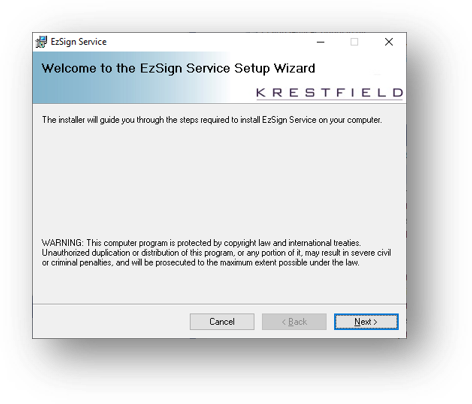

Click **Next**

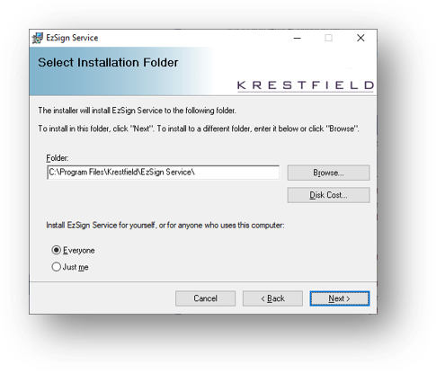

You will be guided through the installation steps, including selecting the installation directory. By default, EzSign Service installs to:

```
C:\Program Files\Krestfield\EzSign Service\
```

<br>

EzSign components are installed under:

```
[Install Location]\EzSign
```

Management scripts are located at:

```
[Install Location]\EzSign\EzSignServer\bin
```

<br>

After completing the wizard, the following components will be installed:

- **EzSign Service Config** (management utility)
- **Krestfield EzSign Service** (Windows Service)

<br>

# Using Previous Settings

To make use of any previous configurations, ensure that you copy across the Service settings from here:

 ```
 C:\Program Data\Krestfield\EzSignService\ezsignservice.properties
 ```

As well as the previous EzSign server configuration files (.properties files) and key store contents

<br> If using an HSM, this must be configured as per previous instances and if any keys are stored on the HSM they must still be available to the EzSign instances. For nCipher Security World’s this will involve copying the remote file system from any old locations/servers to the new

 If you have customised the logging, either replace, or update the log configuration file here:

```
[Installation Directory]\EzSign\EzSignServer\logconf\log4j2.xml
```

<br>

# Configuration

Launch **EzSign Service Config** from the Start Menu or desktop shortcut

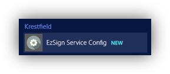

The utility displays existing server configurations and allows you to add, edit, rename, or delete EzSign Server instances

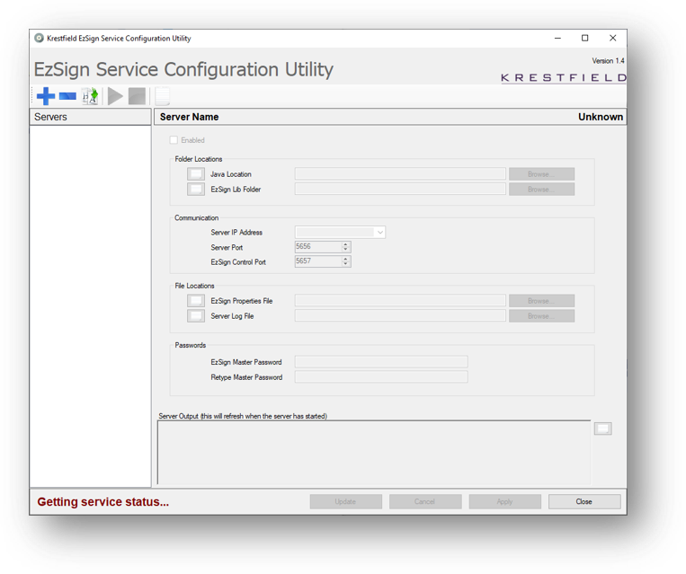

<br>

## Adding a New Server

1. Click **Add Server**.

   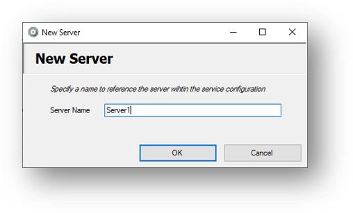

2. Enter a descriptive server name and click OK

3. Populate the required configuration fields

   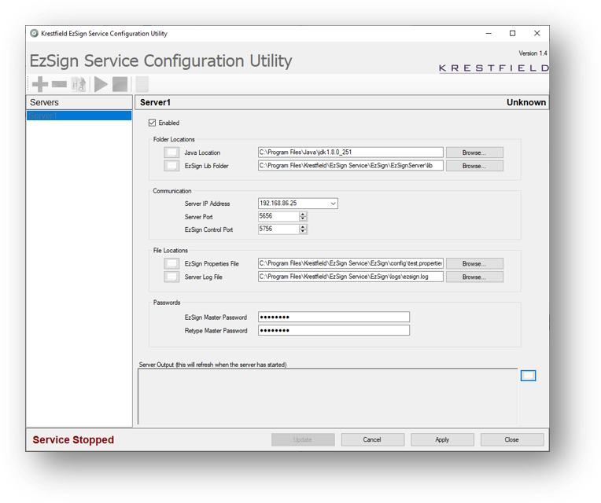

<br>

## Configuration Fields

* Enabled
  * If checked, the server will start automatically when the EzSign Service starts

<br>

* Java Location

  - Automatically populated if `JAVA_HOME` is set
  
  
  - Otherwise, browse to the Java installation directory
  - To use the bundled Java, select: ``[Install Location]\EzSign\EzSignServer\java\jdk-26.0.1``


  - EzSign Lib Folder

* - Defaults to the installed EzSign library folder

  - May be updated to point to another EzSign installation

<br>

* Server IP Address

  - IP address the server will bind to

  - Use `*` to bind to all interfaces

* Server Port

  - Port used for client requests

  - Must be unique and unused

* EzSign Control Port

  - Port used for control messages

  - Must be unique and unused

<br>

* EzSign Properties File

  - Path to the server’s `.properties` configuration file

  - Defaults to the test properties file

* Server Log File

  - Path to the server log file

  - Defaults to the installation log directory

<br>

* EzSign Master Password

  - Required master password for the server

  - Defaults to `"password"` in test configurations

<br>

Click **Apply** to save changes. A message will confirm:

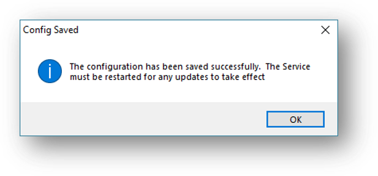

Additional Servers may be added, listening on different interfaces and ports if required, all of which will be managed by the Service

<br>

To edit a Server, click the **Update** button, make the required changes and then click **Apply**. Note, any updates made will not come in to effect until the Service is restarted. To cancel updating (and revert to the settings before the update button was pressed), click **Cancel**

<br>

If you wish to rename a Server, click the **Server Rename** button:                              

<br>

To delete a Server, select the Server to delete and click the **Delete** button:  

<br>

# Starting the Service

To start the Service, click the **Start Service** button:     


Alternatively, start the EzSign Service directly from the Windows Services snapin

The Service will begin start up: 

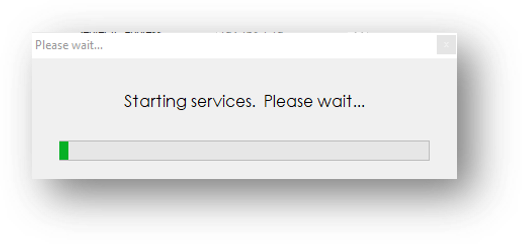

This can take several seconds…

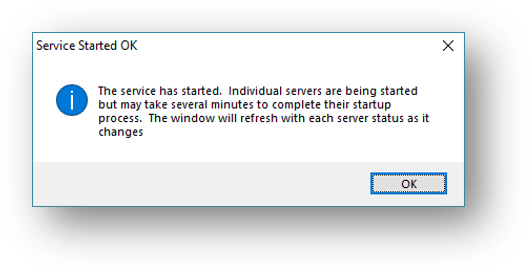

 

Once the Service has started the status displayed in the bottom left will change from:


To


Each Server will then be started. This may take several more seconds for each Server, depending on the configuration (e.g. number of threads and channels etc). Once started, the Server status displayed in the top right of the Server details pane will change from:


To


 

Note, if a server takes longer to start (e.g. if it is configured with many threads or it needs to log on to HSMs) you may see the status **Server Starting**

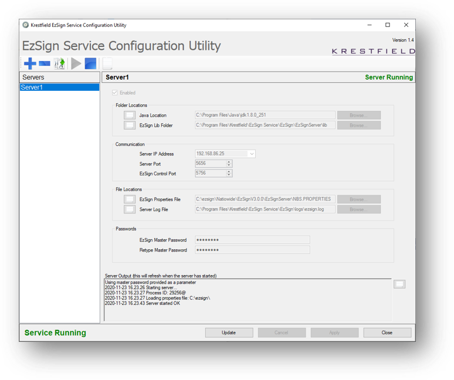

The above image shows the Service running and the Server called *Server1* also running. At this point the Server will be able to accept and process requests from clients

To stop the Service and stop all Servers, click the **Stop Service** button:  

 The Configuration Utility may be closed and re-opened without affecting the running of any Servers

 To view the Service text log, click the  button:

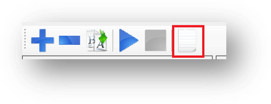

 <br>

# Operation

The configuration utility simply sets the properties for each EzSign *Server* instance and starts or stops the EzSign Service. It also monitors the state of the Service and the state of each of the EzSign Servers (running or stopped)

Closing the configuration utility will not affect the running of the Service

When the Service is started, it loads the configuration as set from the configuration utility. The Service then attempts to start each of the EzSign Server instances in turn

Every ten seconds the Service will contact each of the EzSign Server instances and request their status. If a Server has stopped, an event will be logged. If the Server has not started at the next check (ten seconds later) the Service will attempt to restart the Server

This process will continue until the Service is stopped. During the shutdown process all EzSign Server instances will also be stopped

Note that, by default, the Service runs under the local SYSTEM account. Therefore, if the configuration utility is run under a local user account, ensure that the folders and files configured will also be accessible by the Service

<br>

# Troubleshooting

A *Server* may take several seconds to fully start up. Until it has fully started it will not respond to the control messages and the Server status will remain at *Stopped*

If the status does not change to *Running* after a short time, this indicates a problem with the Server. The configuration may not be correct, there may be permissions issues or there may be another reason for the failure to start

Start by examining the output window at the bottom of the dialog:

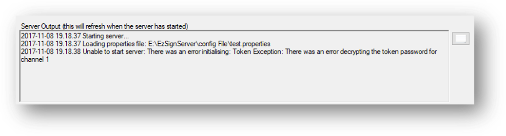

This displays the standard output that the Server would display if started from the command line. This example indicates that the Master Password has not been set correctly

Next examine the **Windows Event Log**. Events will be raised under Event ID: 5656 in the **Application** event log . Information events will indicate when the Service has started, Error events will indicate issues, for example:

```
The EzSign Server Server 1 listening on control port 5760 and IP address 127.0.0.1 
is still not running. 
Attempting a restart...Check the Server log files for more details. 
```

The Server Log file can be opened by clicking the button next to the Server Log File entry:

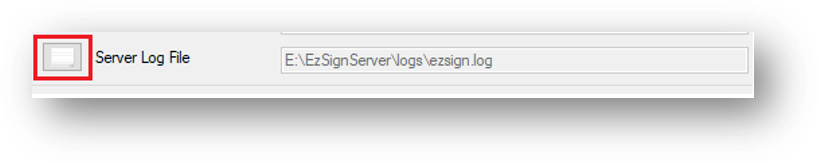

This will display the full Server log which includes all errors and events

 <br>

Service details may be available in the **Service Text log** located here:

```
C:\ProgramData\Krestfield\EzSignService\Servicelog.txt
```

 

Which can also be opened by clicking the **View Service Log** button:   

 This log will indicate if a Server is failing to start and when a restart has been attempted. But the reason for the failure should be evident in the other logs

<br>

# Support

<br>

EzSign documentation: [https://krestfield.github.io/docs/ezsign/ezsign.html](https://krestfield.github.io/docs/ezsign/ezsign.html?utm_source=copilot.com)

Support contact options:

- Email: **support@krestfield.com**
- Web: **[https://www.krestfield.com/support](https://www.krestfield.com/support?utm_source=copilot.com)**

For Silver and Gold Support customers, the dedicated telephone support number may also be used
